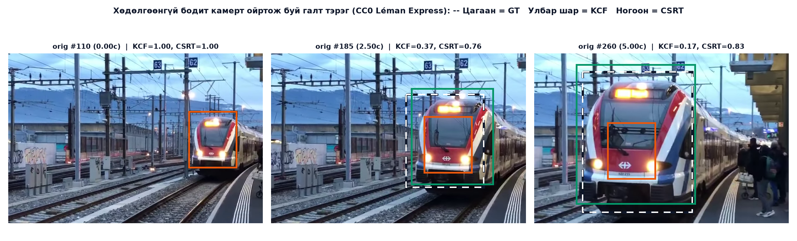
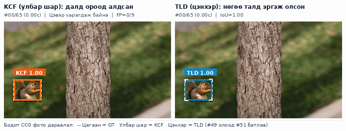
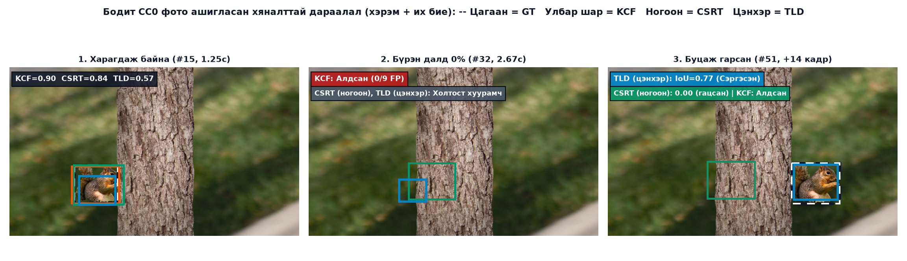

# Объект дагах ба оптик урсгал

OpenCV-ээр бодит бичлэг болон гэрэл зургаар үүсгэсэн хяналттай дараалал дээр объект дагах найман аргыг харьцуулж, камерын хөдөлгөөн оптик урсгалд хэрхэн нөлөөлөхийг хэмжив.


*Зураг 1. Галт тэрэг ойртоход KCF-ийн улбар шар хүрээ ижил хэмжээтэй үлдэж, CSRT-ийн ногоон хүрээ галт тэрэгтэй хамт тэлж байна.*

**Нэг бичлэг, ижил 150 үнэлгээний кадр.** Дундаж IoU нь KCF-д **0.4400**, CSRT-д **0.7767** байв. IoU нь хоёр хүрээний давхцсан талбайг нийлсэн талбайд хуваасан 0–1 оноо. Энд `IoU ≥ 0.50`-ийг амжилттай дагасан гэж тооцсон. [Галт тэрэгний хэмжилт](results/csv/phone_commons_leman_express_summary.csv) · [Хөдөлгөөнгүй гол кадрууд](results/figures/custom_videos/tracking_demo_keyframes.png)

Нүүрийн GIF нь `684 × 285`, `10 FPS`, `5.10 сек`. Бичлэгийн `#110–#260` кадрыг хоёр талд ижил хугацаагаар үзүүлсэн. Эх бичлэгийг `Thibaut120094` авсан бөгөөд `CC0 1.0` лицензтэй. [Léman Express, Wikimedia Commons](https://commons.wikimedia.org/wiki/File:Arriv%C3%A9e_en_gare_du_L%C3%A9man_Express_pour_Coppet_(2019-12-16).webm) · [Эх дүрс ба лиценз](NOTICE.md)

## Үр дүн

| Оролт | Нөхцөл ба үнэлсэн кадр | Гол хэмжилт |
| --- | --- | --- |
| Léman Express | `1280 × 720`, 30 FPS, ойртож буй галт тэрэг, 150 кадр | CSRT **0.7767**, KCF **0.4400** дундаж IoU. Найман аргын дундаас MEDIANFLOW **0.7851**-ээр тэргүүлсэн. |
| `stable` | `1920 × 1080`, 23.976 FPS, тогтмол камер, тэрэгний `#664–#721` мужаас 57 кадр | CSRT, CSRT_REDETECT **0.8505** дундаж IoU. Хоёулаа **57/57** кадрт IoU ≥ 0.50. |
| `moving_camera` | `1920 × 1080`, 25 FPS, тэрэгний 360° камер, нохойны `#405–#515` мужаас 110 кадр | BOOSTING **0.5099**, хөдөлгөөнгүй хүрээний суурь арга **0.4806**, CSRT **0.4695** дундаж IoU. |
| `occlusion` | `720 × 1280`, 24 FPS, алим тунгалаг хавтангийн цаагуур өнгөрөх `#42–#235` мужаас 193 кадр | KCF **0.7190** дундаж IoU. CSRT **193/193** кадрт IoU ≥ 0.50. Алим бүрэн алга болоогүй. |
| `squirrel_occlusion` | `720 × 420`, 12 FPS, фотоноос үүсгэсэн дараалал, харагдах 56 кадр | TLD **0.5131** дундаж IoU. Далд гэж үнэлсэн 9 кадрт TLD **9/9**, KCF **0/9** буруу хүрээ гаргасан. |

[Гурван бичлэгийн бүтэн хэмжилт](results/csv/phone_videos_summary.csv) · [Хэрмийн хэмжилт](results/csv/squirrel_occlusion_summary.csv)

### Объект ойртоход хүрээ тэлэх үү?

`stable` бичлэгт жижиг тэрэгний тэмдэглэсэн хүрээ `98 × 59 px`-ээс `121 × 87 px` болж томорсон. CSRT **0.8505**, MEDIANFLOW **0.8267** дундаж IoU авсан. Тогтмол хэмжээтэй KCF, BOOSTING, MIL-ийн хүрээ тэрэгний төв орчим үлдсэн ч томорсон дүрсийг бага хамарчээ. TLD-ийн хүрээ дээврийн хэсэгт хумигдаж, дундаж IoU **0.4070** болсон. [Тогтвортой камерын CSV](results/csv/phone_stable_summary.csv)


*Зураг 2. Тэрэг томорсон тайрдаст CSRT болон CSRT_REDETECT ижил 0.8505 дундаж IoU авсныг баганан график харуулна.*



*Зураг 3. Галт тэрэгний сүүлчийн кадарт KCF-ийн IoU 0.17, CSRT-ийнх 0.83 болж зөрсөн.*

### Камер хөдөлж байхад дэвсгэрийн хөдөлгөөнийг хасах

Дэвсгэрийн ерөнхий хөдөлгөөнийг цэгээр тооцож (`FB-LK + RANSAC 2D affine`), `DIS_MEDIUM`-ийн пикселийн хөдөлгөөнөөс хасав. `#505`-д дэвсгэрийн медиан шилжилт **5.26-аас 3.37 px** болж **35.85% буурсан**. `#481`-д **8.29-өөс 10.30 px** болж **24.20% өссөн**. Энэ кадрт 2D загварт тохирсон цэгийн хувь 34.1% байсан. Ойрын өвсний параллакс болон линзийн гажилт нөлөөлсөн байж болно. 28 хос кадрын медиан бууралт **13.62%**. [Кадр тус бүрийн хөдөлгөөний CSV](results/csv/phone_moving_camera_flow_pairs.csv) · [Нохой дагасан хүрээний CSV](results/csv/phone_moving_camera_summary.csv)


*Зураг 4. Дээд мөрөнд нөхөлтийн дараа дэвсгэрийн урсгал багассан бол доод мөрөнд зүүн дээд хэсгийн үлдэгдэл урсгал нэмэгдсэн.*

### Шилээр өнгөрөх, бүрэн далд орох хоёр тохиолдол

Алим шилээр өнгөрөхдөө сунаж харагдсан. CSRT, CSRT_REDETECT хоёр **193 кадр бүрд** босгыг хангасан. KCF дундаж IoU-аар тэргүүлсэн ч босгыг бүх кадрт хангаагүй. MIL шилнээс гарсан заагаас 31 кадрын дараа босгод хүрсэн. [Алимны хэмжилт](results/csv/phone_occlusion_summary.csv)


*Зураг 5. Алим шилний цаана байх хоёр хэсгийг сүүдэрлэсэн бөгөөд CSRT-ийн шугам 0.50 босгоос доош ороогүй.*

Хэрмийн дарааллыг хоёр CC0 гэрэл зургаар үүсгэсэн. 25-аас цөөн харагдах маскны пикселтэй кадрыг далд гэж үнэлэв. `#28`-д маскны 0.05% харагдаж, `#29–#36`-д харагдах маск 0, `#37`-д хэрэм дахин харагдсан. Нийт **66 кадр**, GIF-ийн урт **5.50 сек**. [Кадрын шошго](results/csv/squirrel_occlusion_gt.csv) · [Фотоны эх сурвалж](NOTICE.md)



*Зураг 6. KCF далд үед хүрээ гаргаагүй бөгөөд хэрмийг эргэж олоогүй, харин TLD буруу хүрээ гаргасан ч #49-д IoU 0.7535 хүрч #51-д сэргэлтийн шалгуурыг хангасан.*



*Зураг 7. Хэрэм буцаж гарсан #51-д TLD хэрэм дээр, CSRT-ийн хүрээ модны их бие дээр байна.*

Хүснэгтийн `Failure %` нь харагдах кадрт хүчинтэй хүрээ гараагүй хувь. `FP` нь далд гэж үнэлсэн кадрт гарсан буруу хүрээ. Сэргэлтийн эхний кадр болон IoU ≥ 0.50 гурван кадр дараалан хангасныг баталсан кадрыг `#37`-оос тоолов.

| Алгоритм | Mean IoU | IoU ≥ 0.50 | Failure % | Далд кадрын FP (`9` кадр) | Сэргэлт (`first/confirmed`) | Algo FPS |
| :--- | :---: | :---: | :---: | :---: | :---: | :---: |
| **`TLD`** | **0.5131** | **66.07%** | 0.00% | 9 / 9 (`100%`) | **`12 / 14` (`#49 / #51`)** | 49.15 |
| `MEDIANFLOW` | 0.3672 | 37.50% | 0.00% | 9 / 9 (`100%`) | Эргэж олоогүй | **1259.15** |
| `MIL` | 0.3543 | 35.71% | 0.00% | 9 / 9 (`100%`) | Эргэж олоогүй | 52.40 |
| `CSRT` / `CSRT_REDETECT` | 0.3533 | 35.71% | 0.00% | 9 / 9 (`100%`), `redet=0` | Эргэж олоогүй | 54.03 / 53.10 |
| `BOOSTING` | 0.3415 | 35.71% | 0.00% | 9 / 9 (`100%`) | Эргэж олоогүй | 46.65 |
| **`KCF`** | 0.3043 | 35.71% | 60.71% | **`0 / 9` (`0.00%`)** | Эргэж олоогүй | 827.39 |
| `STATIC` *(суурь)* | 0.0862 | 7.14% | 0.00% | 9 / 9 (`100%`) | Эргэж олоогүй | *(хассан)* |

### Арга, хэмжилтийн нөхцөл

- **Даалгаврын давталт.** `06-Tracking-APIs.ipynb - Colaboratory.pdf`-ийн 1–2-р хуудасны BOOSTING, MIL, KCF, TLD, MEDIANFLOW дагагчийг OpenCV 4.14.0 болон 5.0.0-ийн API-тай тулгасан. `06-Optical-Flow.ipynb - Colaboratory.pdf`-ийн 1–3-р хуудасны Shi–Tomasi + Lucas–Kanade (`winSize=200×200`) болон Farnebäck-ийн HSV дүрслэлийг давтсан. [Давтах скрипт](reproduce_pdf.py) · [OpenCV API шалгалт](results/csv/tracker_bindings_cv414.csv) · [Вебкамерын 12/12 кадрын шалгалт](results/csv/webcam_smoke.csv)
- **Объект дагах.** Бичлэгийн нэг ижил кадрын муж, анхны хүрээг бүх аргад өгсөн. Анхны кадрыг оноонд оруулаагүй. KCF ба CSRT объектын дүрсийг корреляцийн шүүлтүүрээр хайдаг. BOOSTING ба MIL эргэн тойрны хүрээнүүдийг ялгаж сурах загвараа шинэчилдэг. MEDIANFLOW цэгийн хөдөлгөөн ашигладаг. TLD дагах болон дахин илрүүлэх шаттай. CSRT_REDETECT нь алдагдлын дохиогоор загварыг дахин хайдаг. STATIC туршилт анхны хүрээг хөдөлгөхгүй барьдаг суурь арга. [Дагагчийн код](trackers.py) · [Үнэлгээний код](benchmark_track.py)
- **Оптик урсгал.** Lucas–Kanade сонгосон цэгүүдийг, Farnebäck ба DIS дүрсний нягт хөдөлгөөнийг тооцно. Хөдөлгөөний бодит векторын шошготой өгөгдөлд таамагласан болон бодит векторын төгсгөлийн зөрүүг EPE-ээр (пиксел) хэмжсэн. Гурван нэмэлт бичлэгт урсгалын шошго байхгүй тул камерын нөхөлтийн өмнөх ба дараах дэвсгэрийн шилжилтийг харьцуулсан. [Оптик урсгалын код](benchmark_flow.py)

| Бодит векторын шошготой хос | Farnebäck EPE (px) | DIS_MEDIUM EPE (px) |
| --- | ---: | ---: |
| Middlebury RubberWhale | 0.3612 | 0.2258 |
| Middlebury Grove2 | 0.5852 | 0.3189 |
| MPI Sintel alley_1 clean | 0.8406 | 0.2581 |
| MPI Sintel ambush_5 final | 4.1480 | 2.4601 |

Энд бүх хүчинтэй пикселийн дундаж EPE-г харьцуулсан. [Бүрэн EPE хүснэгт](results/csv/flow_summary.csv) · [Харьцуулсан график](results/figures/flow_error_and_dis_cc0.png)

### Дүгнэлт ба хязгаарлалт


*Зураг 8. Зүүн талд галт тэрэгний #260-д CSRT 0.83, KCF 0.17 IoU авсан, баруун талд хэрмийн #51-д TLD 0.77 хүрэхэд CSRT-ийн хүрээ холтос дээр үлдсэн.*

Хэрмийн туршилт объектоо алдсанаа мэдэх ба эргэж олох хоёр тусдаа чадвар болохыг харуулсан. Энд CSRT_REDETECT-ийн дахин хайлт огт асаагүй. Өмнөх хяналттай дугуйн туршилтад CSRT_REDETECT дахин олж чадсан, LaSOT-ийн `bicycle-11`-д сэргээгүй. Халхлалтын 3, 11, 22 кадрын туршилтын 11 кадртай төөрөгдүүлэгч бүхий хувилбарт TLD 31 кадрт төстэй объектыг андуурсан. Эдгээр үр дүнг тайрдас бүрийн нөхцөлд тайлбарлав. [Дугуйн туршилт](results/csv/track_summary.csv) · [Халхлалтын шатлал](results/csv/track_occlusion_ladder.csv) · [LaSOT хэмжилт](results/csv/track_generalization_lasot.csv)

<details>
<summary>Галт тэрэг, үндсэн гурван бичлэгийн дэлгэрэнгүй хэмжилт</summary>

**Léman Express.** `#110–#260` мужийн 151 кадраас эхний кадрыг хасаж үнэлсэн. `#246`-д `DIS_MEDIUM`-ийн дэвсгэрийн хөдөлгөөн 3.56-аас 0.36 px болж 89.98% буурсан. 38 хос кадрын медиан бууралт 74.91%. [Галт тэрэгний урсгалын CSV](results/csv/phone_commons_leman_express_flow_pairs.csv)

| Tracker | Mean IoU | IoU ≥ 0.50 (%) | Failure % | Algo ms (FPS) | E2E ms (FPS) |
| :--- | :---: | :---: | :---: | :---: | :---: |
| **`MEDIANFLOW`** | **0.7851** | **100.00%** | 0.0% | 2.09 (477.81) | 10.16 (98.46) |
| **`CSRT`** | **0.7767** | **100.00%** | 0.0% | 27.37 (36.53) | 37.38 (26.75) |
| **`CSRT_REDETECT`** | **0.7767** | **100.00%** | 0.0% | 27.68 (36.13) | 37.79 (26.46) |
| `TLD` | 0.4595 | 32.00% | 0.0% | 56.88 (17.58) | 60.87 (16.43) |
| `MIL` | 0.4401 | 34.00% | 0.0% | 18.45 (54.20) | 27.68 (36.13) |
| **`KCF`** | **0.4400** | **34.00%** | 0.0% | 3.49 (286.41) | 18.69 (53.50) |
| `BOOSTING` | 0.4327 | 31.33% | 0.0% | 32.59 (30.68) | 41.76 (23.95) |
| `STATIC` *(суурь)* | 0.2870 | 22.67% | 0.0% | — | 8.11 (123.29) |

**Гурван үндсэн бичлэг.** Алгоритмын хугацааг нэг урсгалтай CPU дээр хэмжсэн. `Algo` нь дагагчийн хугацаа, `E2E` нь кадр унших, боловсруулах зэрэг оролт, гаралттай нийт хугацаа. STATIC-ийг алгоритмын хурдны эрэмбэд оруулаагүй. [Нэгдсэн CSV](results/csv/phone_videos_summary.csv)

| Бичлэг | Tracker | Mean IoU | IoU ≥ 0.50 (%) | Failure % | Drift (`IoU<0.2`) | Сэргэлт (`first/conf`) | Algo FPS | E2E FPS |
| :--- | :--- | :---: | :---: | :---: | :---: | :---: | :---: | :---: |
| `stable` | **`CSRT`** / **`CSRT_REDETECT`** | **0.8505** | **100.00%** | 0.0% | 0 | — | 53.78 / 50.68 | 35.08 / 35.35 |
| `stable` | `MEDIANFLOW` | 0.8267 | 100.00% | 0.0% | 0 | — | 192.88 | 71.41 |
| `stable` | `MIL` / `BOOSTING` / `KCF` | 0.7316 / 0.7268 / 0.7213 | 100.00% | 0.0% | 0 | — | 35.3–139.0 | 32.5–40.0 |
| `stable` | `TLD` | 0.4070 | 26.32% | 0.0% | 0 | — | 15.48 | 12.91 |
| `stable` | `STATIC` *(суурь)* | 0.0917 | 7.02% | 0.0% | 48 | — | *(хассан)* | 119.68 |
| `moving_camera` | **`BOOSTING`** | **0.5099** | **57.27%** | 0.0% | 1 | — | 46.72 | 24.72 |
| `moving_camera` | `STATIC` *(суурь)* | 0.4806 | 41.82% | 0.0% | 0 | — | *(хассан)* | 56.47 |
| `moving_camera` | `CSRT` / `CSRT_REDETECT` | 0.4695 | 40.00% | 0.0% | 1 | — | 25.58 / 25.07 | 15.83 / 15.65 |
| `moving_camera` | `KCF` | 0.3888 | 22.73% | 12.73% | 1 | — | 33.23 | 15.44 |
| `moving_camera` | `TLD` / `MIL` / `MEDIANFLOW` | 0.3168 / 0.2088 / 0.1180 | 32.73 / 9.09 / 3.64% | 0.0% | 46 / 70 / 88 | — | 18.2–206.1 | 14.0–43.7 |
| `occlusion` | **`KCF`** | **0.7190** | 98.96% | 0.0% | 0 | Шилний дараа `≥0.5` (`#131/133`) | 68.88 | 35.73 |
| `occlusion` | **`CSRT`** / **`CSRT_REDETECT`** | **0.6225** | **100.00%** | 0.0% | 0 | **Тасралтгүй (`193/193`)** | 33.92 / 33.21 | 25.32 / 24.91 |
| `occlusion` | `BOOSTING` | 0.6395 | 94.82% | 0.0% | 0 | Шилний дараа `≥0.5` (`#131/133`) | 35.67 | 28.73 |
| `occlusion` | `MIL` | 0.4187 | 34.20% | 0.0% | 0 | 31 / 33 (`162/164`) | 54.03 | 39.58 |
| `occlusion` | `MEDIANFLOW` | 0.3099 | 41.97% | 18.13% | 63 | Эргэж олоогүй | 500.86 | 114.63 |
| `occlusion` | `TLD` | 0.3058 | 5.18% | 0.0% | 23 | Эргэж олоогүй | 16.70 | 15.02 |
| `occlusion` | `STATIC` *(суурь)* | 0.2695 | 23.83% | 0.0% | 126 | 22 / 24 (`153/155`) | *(хассан)* | 149.65 |

</details>

## Ажиллуулах

Linux дээр төслийн үндсэн хавтаснаас ажиллуул. Нийтэлсэн хэмжилтийн орчин нь Intel Core 5 120U, нэг CPU урсгал, Python 3.14.4, `opencv-contrib-python==4.14.0.94`, FFmpeg 8.0.1. GIF үүсгэхэд `ffmpeg`, DejaVu Sans фонтууд хэрэгтэй. Эх файл татах команд `curl` ашиглана.

```bash
python3 -m venv .venv
source .venv/bin/activate
python -m pip install -r requirements.txt
```

### Галт тэрэгний хэмжилтийг давтах

```bash
mkdir -p data/commons
curl -fL -o data/commons/leman_express_cc0.webm \
  'https://upload.wikimedia.org/wikipedia/commons/9/9b/Arriv%C3%A9e_en_gare_du_L%C3%A9man_Express_pour_Coppet_%282019-12-16%29.webm'

python custom_video_lab.py --evaluate data/commons/leman_express_cc0.webm \
  --gt results/csv/commons_leman_express_gt.csv --start-frame 110 --end-frame 260 --seq-id commons_leman_express
```

Үндсэн гаралт нь `results/csv/phone_commons_leman_express_summary.csv`. Кадр тус бүрийн хүрээ `results/csv/track_commons_leman_express_*.csv`, урсгалын хэмжилт `results/csv/phone_commons_leman_express_flow_pairs.csv`-д үүснэ.

### Хэрмийн GIF-ийг үүсгэх

Гэрэл зургуудыг скрипт татаж, хяналттай дараалал болон шошгыг үүсгэнэ.

```bash
python squirrel_occlusion_lab.py --rebuild-seq
python make_three_videos_figures.py --only-squirrel
python -m unittest discover -s tests -v
```

Хэмжилт `results/csv/squirrel_occlusion_summary.csv`-д, `squirrel_occlusion.gif` ба `squirrel_occlusion_keyframes.png` нь `results/figures/custom_videos/`-д үүснэ.

### PDF-ийн давталт ба бүтэн туршилт

Галт тэрэг, хэрмийн дээрх командыг ажиллуулсны дараа гурван эх MP4-ийг `data/phone_videos/` дотор `stable.mp4`, `moving_camera.mp4`, `occlusion.mp4` нэрээр байрлуул. Эх файлын хувилбар, кадрын мужийг төслийн бүртгэлтэй тулга. Гурван MP4-ийн дахин нийтлэх зөвшөөрөл баталгаажаагүй тул тайланд хэмжилт болон эх кадргүй график оруулсан. [Эх өгөгдөл ба лицензийн бүртгэл](NOTICE.md)

```bash
python dataset_prep.py --all
python reproduce_pdf.py --mode all-pdf --no-show
python benchmark_flow.py && python benchmark_track.py
python custom_video_lab.py --run-three
python make_figure.py && python make_three_videos_figures.py
```

PDF-ийн давталтын бичлэг `results/videos/pdf_replay_*.mp4`-д, хэмжилт `results/csv/`-д, тайлангийн зураг `results/figures/`-д үүснэ.

[Тохиргоо](config.py) · [Хэмжүүрийн тооцоо](metrics.py) · [Өгөгдөл бэлтгэх код](dataset_prep.py) · [Зураг үүсгэх код](make_three_videos_figures.py) · [Тестүүд](tests/test_metrics_and_pipeline.py) · [Суурь туршилтын график](results/figures/tracking_flow_metrics.png) · [Word тайлан үүсгэх код](build_report.py)
