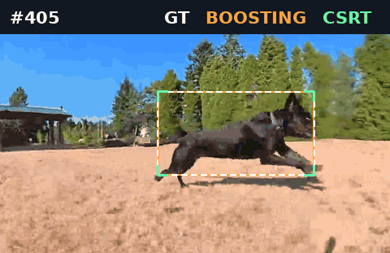
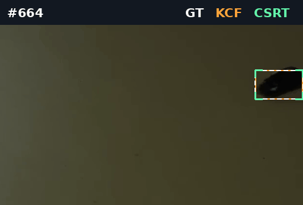
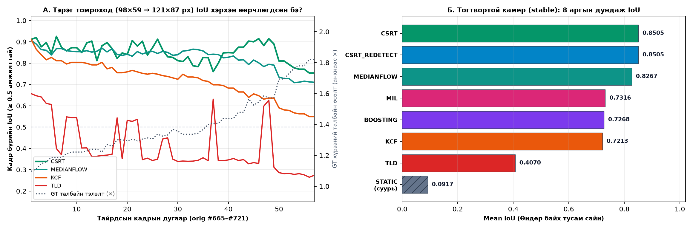
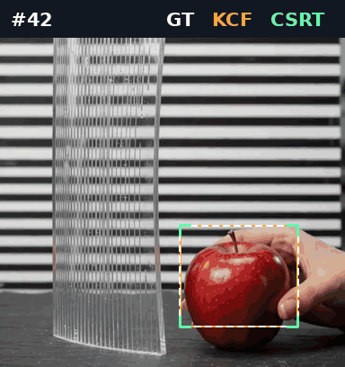
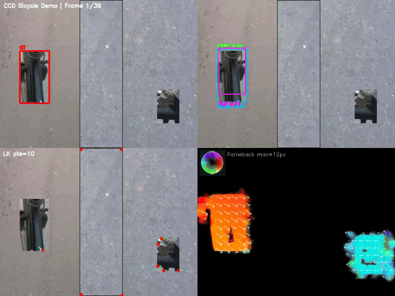

# Объект дагах ба оптик урсгал

OpenCV-ээр бодит бичлэг болон гэрэл зургаар үүсгэсэн дараалал дээр объект дагах найман аргыг харьцуулж, камерын хөдөлгөөний нөлөөг хэмжсэн. **Нохойн эх бичлэг дээр BOOSTING хамгийн өндөр оноо авсан. Тэрэг ойртоход CSRT хүрээгээ тэлсэн. Хэрэм далд ороод гарахад TLD түүнийг дахин олсон.**

## 1. Камер хөдөлж байхад нохойг дагаж чадах уу?

Бичлэгийг бүрдүүлдэг нэг зургийг **кадр** гэдэг. Эхний кадрт хүн нохойг тэгш өнцөгтөөр тойруулж, хүрээний байрлал, хэмжээг хүснэгтийн файлд (CSV) тэмдэглэсэн. Код тэр хүрээг уншиж, дараагийн кадр бүрд нохойг хайна. Олсон гэж үзвэл шинэ хүрээ зурна. Үүнийг **объект дагах** гэдэг.



*Цагаан тасархай хүрээ нь хүн нохойг тойруулж тэмдэглэсэн жишиг хүрээ. Улбар шар хүрээг BOOSTING, ногоон хүрээг CSRT гаргасан.*

GIF дээр жишиг хүрээг `GT` гэж тэмдэглэсэн. 451-р кадрт цагаан хүрээний төвөөс BOOSTING-ийн хүрээний төв 199 пиксел (px), CSRT-ийнх 227 пиксел зүүн тийш зөрсөн.

**IoU** нь хоёр хүрээ хэр давхцаж байгааг хэмждэг 0–1 оноо. Хоёр хүрээ нийлээд 100 нэгж талбай эзэлж, 60 нэгж нь давхцвал IoU **0.60**. Энэ туршилтад `IoU ≥ 0.50` бол тухайн кадрт объектыг амжилттай дагасан гэж тооцсон. [Нэр томьёоны тайлбар](#нэр-томьёоны-тайлбар)

Эх MP4 дээр ижил анхны хүрээ, ижил 110 кадраар үнэлэхэд BOOSTING **0.5099**, анхны хүрээг хөдөлгөөгүй STATIC **0.4806**, CSRT **0.4695** дундаж IoU авсан. BOOSTING-ийн оноо STATIC-аас **0.0293**-аар илүү байв.

GIF-ийн дүрсийг GitHub-д оруулсан дахин кодлосон MP4-өөс авсан. Өнгөт хүрээнүүдийг эх MP4 дээрх хэмжилтийн CSV файлаас уншиж зурсан. [GIF үүсгэх код](make_three_videos_figures.py) · [Давтан хэмжилт](#нохойны-бичлэгийн-давтан-хэмжилт)

**Эх тайрдас `#405–#515`** · Эх 111 кадр · GIF 49 кадр · Үнэлсэн 110 кадр · [Бүтэн MP4](data/phone_videos/moving_camera.mp4) · [Кадр бүрд тэмдэглэсэн жишиг хүрээ](results/csv/phone_moving_camera_gt.csv) · [BOOSTING](results/csv/track_moving_camera_BOOSTING.csv) · [CSRT](results/csv/track_moving_camera_CSRT.csv) · [Хэмжилтийн дүн](results/csv/phone_moving_camera_summary.csv)

Гурван GIF-д кадрыг эх бичлэгийн дугаараар тэмдэглэсэн. Дугаар 0-ээс эхэлнэ. [Нэгдсэн хэмжилт](results/csv/phone_videos_summary.csv) · [Эх дүрсний бүртгэл](NOTICE.md)

Камер эргэхэд өвс, мод хүртэл хөдөлж харагдана. Энэ шилжилтийн хэд нь камераас үүссэнийг тооцоод нийт шилжилтээс хассан. Үүнийг **камерын хөдөлгөөний нөхөлт** гэдэг.

**Оптик урсгал** нь зургийн цэгүүд дараагийн кадрт хаашаа, хэр хол шилжсэнийг тооцно. Нийт шилжилтийг `DIS_MEDIUM`-ээр, камераас үүссэн шилжилтийг `FB-LK + RANSAC 2D affine` аргаар тооцсон.

**Медиан** гэдэг нь утгуудыг эрэмбэлэхэд голд байгаа утга. Хоёр утга голд таарвал тэдгээрийн дунджийг авна. Нөхөлтийн дараа `#505`-д дэвсгэрийн медиан шилжилт **5.26-аас 3.37 px** болж **35.85% буурсан**. `#481`-д **8.29-өөс 10.30 px** болж **24.20% өссөн**. Энэ кадрт цэгүүдийн 34.1%-ийн хөдөлгөөн камерын шилжилтийг дүрсэлсэн 2D загварт таарсан. Камер хөдлөхөд ойрын өвс холын дэвсгэрээс өөр хэмжээгээр шилжиж харагддаг. Үүнийг **параллакс** гэдэг. Энэ ялгаа болон линзийн гажилт үр дүнд нөлөөлсөн байж болно. 28 хос кадраар тооцсон медиан бууралт **13.62%** байв. [Кадр тус бүрийн хөдөлгөөний CSV](results/csv/phone_moving_camera_flow_pairs.csv) · [Нохой дагасан хүрээний CSV](results/csv/phone_moving_camera_summary.csv)


*Дээд мөрөнд нөхөлтийн дараа дэвсгэрийн урсгал багассан бол доод мөрөнд зүүн дээд хэсгийн үлдэгдэл урсгал нэмэгдсэн.*

## 2. Тэрэг ойртоход хүрээ нь дагаж томрох уу?



*Тэрэг ойртоход KCF-ийн улбар шар хүрээ 98 × 59 px хэвээр үлдэж, CSRT-ийн ногоон хүрээ сүүлийн кадрт 115 × 69 px болж тэлж байгааг ажиглаарай.*

**Эх тайрдас `#664–#721`** · Эх 58 кадр · GIF 27 кадр · Үнэлсэн 57 кадр · [Бүтэн MP4](data/phone_videos/stable.mp4) · [Кадр бүрд тэмдэглэсэн жишиг хүрээ](results/csv/phone_stable_gt.csv) · [KCF](results/csv/track_stable_KCF.csv) · [CSRT](results/csv/track_stable_CSRT.csv) · [Хэмжилтийн дүн](results/csv/phone_stable_summary.csv)

`stable` бичлэгт жижиг тэрэгний тэмдэглэсэн хүрээ `98 × 59 px`-ээс `121 × 87 px` болж томорсон. CSRT **0.8505**, MEDIANFLOW **0.8267**, KCF **0.7213** дундаж IoU авсан. CSRT үнэлгээний **57/57** кадрт 0.50 босгыг хангав. Тогтмол хэмжээтэй KCF, BOOSTING, MIL-ийн хүрээ тэрэгний төв орчим үлдсэн ч томорсон дүрсийг бага хамарчээ. TLD-ийн хүрээ дээврийн хэсэгт хумигдаж, дундаж IoU **0.4070** болсон.



*Тэрэг томорсон тайрдаст CSRT болон CSRT_REDETECT ижил 0.8505 дундаж IoU авсныг баганан график харуулна.*

## 3. Алим шилний цаана сунаж харагдахад дагагч алдах уу?



*Алим тунгалаг хавтангийн цаагуур ороход дүрс нь сунаж гажиж, хавтангийн ирмэгээс гарахад буцаад дугуувтар болж байгааг ажиглаарай.*

**Эх тайрдас `#42–#235`** · Эх 194 кадр · GIF 89 кадр · Үнэлсэн 193 кадр · [Бүтэн MP4](data/phone_videos/occlusion.mp4) · [Кадр бүрд тэмдэглэсэн жишиг хүрээ](results/csv/phone_occlusion_gt.csv) · [KCF](results/csv/track_occlusion_KCF.csv) · [CSRT](results/csv/track_occlusion_CSRT.csv) · [Хэмжилтийн дүн](results/csv/phone_occlusion_summary.csv)

Алим бүх кадрт харагдсан. Бүрэн далд кадрын тоо 0 (`absent_frames = 0`). CSRT, CSRT_REDETECT хоёр **193/193** кадрт босгыг хангасан. KCF **0.7190** дундаж IoU-аар тэргүүлж, **191/193** кадрт босгыг хангасан. Алим шилний цаанаас гарснаас 31 кадрын дараа MIL гурван кадр дараалан IoU ≥ 0.50 хангасан. Гурав дахь кадр буюу шилнээс гарснаас 33 кадрын дараа сэргэлт батлагдсан.


*Алим шилний цаана байх хоёр хэсгийг сүүдэрлэсэн бөгөөд CSRT-ийн шугам 0.50 босгоос доош ороогүй.*

## 4. Хэрэм модны цаанаас гарахад дагагч эргэж олох уу?

Мод хэрмийг халхлахад хэрэм хэсэгчлэн эсвэл бүрэн далд орно. Буцаж гарсны дараа алгоритм хэрмийн байрлалыг хангалттай зөв олж эхэлбэл дагалт **сэргэсэн** гэж үзнэ.

Дарааллыг хоёр CC0 гэрэл зургаар үүсгэсэн. **Маск** нь зургийн аль пиксел нь хэрмийн дүрсэнд багтаж байгааг заана. Харагдах хэрмийн дүрс 25-аас цөөн пикселтэй бол тухайн кадрыг «далд» гэж тооцсон. `#28`-д хэрмийн дүрсний 0.05% харагдсан. `#29–#36`-д харагдах пикселийн тоо 0 байсан. `#37`-д хэрэм дахин гарч ирсэн. Нийт **66 кадр**, GIF-ийн урт **5.50 сек**. [Кадр бүрийн жишиг хүрээ ба харагдах төлөв](results/csv/squirrel_occlusion_gt.csv) · [Фотоны эх сурвалж](NOTICE.md)


*KCF далд үед хүрээ гаргаагүй бөгөөд хэрмийг эргэж олоогүй, харин TLD буруу хүрээ гаргасан ч #49-д IoU 0.7535 хүрч #51-д сэргэлтийн шалгуурыг хангасан.*


*Хэрэм буцаж гарсан #51-д TLD хэрэм дээр, CSRT-ийн хүрээ модны их бие дээр байна.*

**Сэргэлт** гэж тооцохын тулд хүрээний давхцлын оноо (IoU) гурван кадр дараалан 0.50 буюу түүнээс дээш байх ёстой. Хүснэгтийн `first` нь тэр гурван кадрын эхнийх, `confirmed` нь гурав дахь нь. Хэдэн кадр хүлээснийг хэрэм буцаж гарсан `#37`-оос тоолсон.

| Алгоритм | Mean IoU | IoU ≥ 0.50 | Failure % | Далд кадрын FP (`9` кадр) | Сэргэлт (`first/confirmed`) | Algo FPS |
| :--- | :---: | :---: | :---: | :---: | :---: | :---: |
| **`TLD`** | **0.5131** | **66.07%** | 0.00% | 9 / 9 (`100%`) | **`12 / 14` (`#49 / #51`)** | 49.15 |
| `MEDIANFLOW` | 0.3672 | 37.50% | 0.00% | 9 / 9 (`100%`) | Эргэж олоогүй | **1259.15** |
| `MIL` | 0.3543 | 35.71% | 0.00% | 9 / 9 (`100%`) | Эргэж олоогүй | 52.40 |
| `CSRT` / `CSRT_REDETECT` | 0.3533 | 35.71% | 0.00% | 9 / 9 (`100%`), `redet=0` | Эргэж олоогүй | 54.03 / 53.10 |
| `BOOSTING` | 0.3415 | 35.71% | 0.00% | 9 / 9 (`100%`) | Эргэж олоогүй | 46.65 |
| **`KCF`** | 0.3043 | 35.71% | 60.71% | **`0 / 9` (`0.00%`)** | Эргэж олоогүй | 827.39 |
| `STATIC` *(суурь)* | 0.0862 | 7.14% | 0.00% | 9 / 9 (`100%`) | Эргэж олоогүй | *(хассан)* |

### Дугуй бүрэн далд ороод дахин гарч ирэх жишээ

CC0 гэрэл зургаас бэлтгэсэн энэ дараалалд дугуйн дүрс саадны цаагуур орж, нөгөө талаас гарч ирнэ.



*Зүүн дээд талын улаан хүрээ нь жишиг байрлал, баруун дээд талын өнгөт хүрээнүүд нь алгоритмуудын олсон байрлал. Доод хоёр хэсэгт зургийн цэгүүдийн зам болон дүрсний шилжилтийг харуулсан.*

[Бүтэн MP4 (4.88 сек)](results/figures/demo_bicycle_occlusion.mp4) · [Дугуйн туршилтын хэмжилт](results/csv/track_summary.csv) · [Эх зураг ба лиценз](NOTICE.md)

## Арга, хэмжилтийн нөхцөл

- **Даалгаврын давталт.** `06-Tracking-APIs.ipynb - Colaboratory.pdf`-ийн 1–2-р хуудасны BOOSTING, MIL, KCF, TLD, MEDIANFLOW дагагчийг OpenCV 4.14.0 болон 5.0.0-ийн API-тай тулгасан. `06-Optical-Flow.ipynb - Colaboratory.pdf`-ийн 1–3-р хуудасны Shi–Tomasi + Lucas–Kanade (`winSize=200×200`) болон Farnebäck-ийн HSV дүрслэлийг давтсан. [Давтах скрипт](reproduce_pdf.py) · [OpenCV API шалгалт](results/csv/tracker_bindings_cv414.csv) · [Вебкамерын 12/12 кадрын шалгалт](results/csv/webcam_smoke.csv)
- **Объект дагах.** Бичлэгийн нэг ижил кадрын муж, анхны хүрээг бүх аргад өгсөн. Анхны кадрыг оноонд оруулаагүй. KCF ба CSRT объектын дүрсийг корреляцийн шүүлтүүрээр хайдаг. BOOSTING ба MIL эргэн тойрны хүрээнүүдийг ялгаж сурах загвараа шинэчилдэг. MEDIANFLOW цэгийн хөдөлгөөн ашигладаг. TLD дагах болон дахин илрүүлэх шаттай. CSRT_REDETECT нь алдагдлын дохиогоор загварыг дахин хайдаг. STATIC туршилт анхны хүрээг хөдөлгөхгүй барьдаг суурь арга. [Дагагчийн код](trackers.py) · [Үнэлгээний код](benchmark_track.py)
- **Оптик урсгал.** Lucas–Kanade сонгосон цэгүүдийг, Farnebäck ба DIS дүрсний нягт хөдөлгөөнийг тооцно. Хөдөлгөөний бодит векторын шошготой өгөгдөлд таамагласан болон бодит векторын төгсгөлийн зөрүүг EPE-ээр (пиксел) хэмжсэн. Гурван нэмэлт бичлэгт урсгалын шошго байхгүй тул камерын нөхөлтийн өмнөх ба дараах дэвсгэрийн шилжилтийг харьцуулсан. [Оптик урсгалын код](benchmark_flow.py)

| Бодит векторын шошготой хос | Farnebäck EPE (px) | DIS_MEDIUM EPE (px) |
| --- | ---: | ---: |
| Middlebury RubberWhale | 0.3612 | 0.2258 |
| Middlebury Grove2 | 0.5852 | 0.3189 |
| MPI Sintel alley_1 clean | 0.8406 | 0.2581 |
| MPI Sintel ambush_5 final | 4.1480 | 2.4601 |

Энд бүх хүчинтэй пикселийн дундаж EPE-г харьцуулсан. [Бүрэн EPE хүснэгт](results/csv/flow_summary.csv) · [Харьцуулсан график](results/figures/flow_error_and_dis_cc0.png)

### Арга бүрийн кодын гол хэсэг

#### Объект дагах

Бүх дагагчийг ижил эхний кадр, CSV-д тэмдэглэсэн ижил хүрээгээр эхлүүлнэ. Хүрээг `(x, y, өргөн, өндөр)` дарааллаар пикселээр өгнө. `x, y` нь хүрээний зүүн дээд булангийн байрлал. `update()` нь тухайн кадрт дагагч объектыг олсон гэж үзсэн эсэх, олсон бол хүрээ нь хаана байгааг буцаана.

| Арга | Төсөлд ашигласан үүсгэгч | Хүрээг яаж олдог вэ? |
| --- | --- | --- |
| STATIC | `StaticBaselineTracker()` | Эхний хүрээг хадгалаад дараагийн кадр бүрд буцаана. |
| BOOSTING | `cv2.legacy.TrackerBoosting_create()` | Объект ба дэвсгэрийг ялгах хэд хэдэн энгийн дүрмийг нэгтгэж, дагах явцад шинэчилнэ. |
| MIL | `cv2.TrackerMIL_create()` | Нэг хүрээг зөв гэж шууд тогтоохын оронд объектын ойролцоох хэд хэдэн хүрээг багцаар нь ашиглаж сурна. |
| KCF | `cv2.TrackerKCF_create()` | Өмнөх дүрстэй хамгийн төстэй хэсгийг ойр орчмоос хайна. Тэрэгний туршилтад хүрээний хэмжээ тогтмол байсан. |
| TLD | `cv2.legacy.TrackerTLD_create()` | Дагалтын зэрэгцээ өмнө сурсан дүрсээр объектыг дахин хайна. |
| MEDIANFLOW | `cv2.legacy.TrackerMedianFlow_create()` | Хүрээн доторх цэгүүдийг урагш, буцааж дагаж шалгаад хүрээний шилжилт, хэмжээг тооцно. |
| CSRT | `cv2.TrackerCSRT_create()` | Объектод хамаарах найдвартай шинжүүдэд илүү жин өгч, байрлал болон хэмжээг шинэчилнэ. |
| CSRT_REDETECT | `CSRTReDetectTracker()` | CSRT-ийн хүрээ итгэлгүй болсон кадрууд дараалбал хадгалсан загвараар дүрсийг дахин хайна. Олдсон байрлал хэдэн кадр дараалан тогтвортой байвал CSRT-г тэндээс эхлүүлнэ. |

Энэ хэсэгт `frames` нь бичлэгээс уншсан кадрууд, `initial_box` нь эхний кадрт CSV-ээс уншсан хүрээний байрлал, хэмжээ. `method`-д хүснэгтийн аль ч аргын нэрийг өгч болно.

```python
from trackers import resolve_tracker_factory, safe_tracker_init

method = "CSRT"
use_legacy = method in {"BOOSTING", "TLD", "MEDIANFLOW"}
factory, binding = resolve_tracker_factory(method, prefer_legacy=use_legacy)
if factory is None:
    raise RuntimeError(f"{method}: {binding}")

tracker = factory()
started, note = safe_tracker_init(tracker, frames[0], initial_box)
if not started:
    raise RuntimeError(note)

for frame in frames[1:]:
    found, box = tracker.update(frame)
    if found:
        x, y, width, height = box
```

[Дагагч үүсгэх, эхлүүлэх код](trackers.py#L212) · [Дахин хайх CSRT-ийн код](trackers.py#L149) · [Туршилтад ажиллуулсан давталт](benchmark_track.py#L154)

#### Оптик урсгал

Shi–Tomasi эхний кадраас цөөн цэг сонгоно. Lucas–Kanade тэдгээр цэг дараагийн кадрт хаана очсоныг олно. Farnebäck ба DIS нь пиксел бүрд хэвтээ, босоо хоёр шилжилт тооцно. Доорх `frame0`, `frame1` нь OpenCV-ээр уншсан дараалсан хоёр кадр.

```python
import cv2

from config import FARNEBACK_PDF, LK_PDF, LK_SMALL, SHI_TOMASI_PDF

gray0 = cv2.cvtColor(frame0, cv2.COLOR_BGR2GRAY)
gray1 = cv2.cvtColor(frame1, cv2.COLOR_BGR2GRAY)

# Shi–Tomasi selects points. Lucas–Kanade follows them.
points0 = cv2.goodFeaturesToTrack(gray0, mask=None, **SHI_TOMASI_PDF)
if points0 is not None:
    for settings in (LK_PDF, LK_SMALL):
        points1, status, _ = cv2.calcOpticalFlowPyrLK(
            gray0, gray1, points0, None, **settings
        )
        tracked_points = points1[status.ravel() == 1]

# Farnebäck and the three DIS presets return a vector per pixel.
farneback = cv2.calcOpticalFlowFarneback(gray0, gray1, None, **FARNEBACK_PDF)
for preset in (
    cv2.DISOPTICAL_FLOW_PRESET_ULTRAFAST,
    cv2.DISOPTICAL_FLOW_PRESET_FAST,
    cv2.DISOPTICAL_FLOW_PRESET_MEDIUM,
):
    dis_flow = cv2.DISOpticalFlow_create(preset).calc(gray0, gray1, None)
```

`status = 1` нь Lucas–Kanade тухайн цэгийг олсон гэж мэдээлснийг заана. Туршилтад `LK_PDF`-ийн **200 × 200** болон `LK_SMALL`-ийн **15 × 15** пикселийн хайлтын цонхыг харьцуулсан. DIS-ийн **ULTRAFAST**, **FAST**, **MEDIUM** нь нэг аргын гурван бэлэн тохиргоо. [Туршилтын тохиргоо](config.py#L36) · [Оптик урсгалын харьцуулалтын код](benchmark_flow.py#L123)

#### Камерын хөдөлгөөнийг хасах

Нохойн бичлэгт Lucas–Kanade-аар цэгүүдийг урагш, буцааж дагаж шалгасан. Үлдсэн цэгүүдийн шилжилтээр RANSAC камерын ерөнхий хөдөлгөөнийг тооцно. Дараа нь нийт урсгалаас камерынхыг хасаж, үлдсэн хөдөлгөөнийг харуулна.

```python
from benchmark_flow import compute_camera_motion_compensation

raw_flow, camera_flow, residual_flow = compute_camera_motion_compensation(
    frame0, frame1, flow_method="dis_medium"
)
```

[Камерын хөдөлгөөн тооцох код](benchmark_flow.py#L418)

### Нэр томьёоны тайлбар

| Үг | Энэ тайланд ямар утгатай вэ? |
| --- | --- |
| **Tracker** буюу дагагч | Дараагийн кадрт биет хаана байгааг таамаглаж, тэгш өнцөгт хүрээ гаргадаг алгоритм. BOOSTING, KCF, CSRT зэрэг нь дагагчийн нэр. |
| **GT** (*ground truth*) | Алгоритмын хүрээг шалгахдаа харьцуулдаг хүрээ. Бодит бичлэгийн хувьд хүн кадр дээр биетийг тойруулж тэмдэглэсэн. Хэрмийн дараалалд харагдаж буй пикселүүдээр хүрээг тооцсон. |
| **Mean IoU** | Үнэлсэн кадруудын хүрээний давхцлын дундаж. Хүснэгтийн `IoU ≥ 0.50 (%)` багана нь босгыг хангасан кадрын хувь. |
| **px**, **EPE** | `px` нь пикселийн нэгж. **EPE** нь тухайн цэгийн таамагласан ба жишиг шилжилтийн сумны үзүүр хоорондын зай. Пикселээр хэмжинэ. |
| **FP**, **Failure %**, **Drift** | FP нь биетийг далд гэж үнэлсэн кадрт гарсан буруу хүрээ. Failure % нь биет харагдаж байхад хүчинтэй хүрээ гараагүй хувь. Drift нь дагагч хүрээ гаргасан ч IoU нь 0.20-оос бага болсон кадрын тоо. |
| **FPS**, **Algo**, **E2E** | FPS нь секундэд ногдох кадрын тоо. GIF-д тоглуулах хурдыг, хэмжилтэд боловсруулах хурдыг заана. Algo нь дагагчийн тооцооны хугацаа. E2E нь бэлэн кадр унших, дагагчийг ажиллуулах, хүрээ зурах, гаралтын MP4 бичих хугацааг хамарна. |
| **CSV** | Хэмжилтийг мөр, баганаар хадгалсан хүснэгтийн файл. Кадр бүрийн утгыг тэндээс шалгаж болно. |

## Дүгнэлт ба хязгаарлалт


*Зүүн талд галт тэрэгний #260-д CSRT 0.83, KCF 0.17 IoU авсан, баруун талд хэрмийн #51-д TLD 0.77 хүрэхэд CSRT-ийн хүрээ холтос дээр үлдсэн.*

Хэрмийн туршилт объектоо алдсанаа мэдэх ба эргэж олох хоёр тусдаа чадвар болохыг харуулсан. Энд CSRT_REDETECT-ийн дахин хайлт огт асаагүй. Өмнөх хяналттай дугуйн туршилтад CSRT_REDETECT дахин олж чадсан, LaSOT-ийн `bicycle-11`-д сэргээгүй. Халхлалтын 3, 11, 22 кадрын туршилтын 11 кадртай төөрөгдүүлэгч бүхий хувилбарт TLD 31 кадрт төстэй объектыг андуурсан. Эдгээр үр дүнг тайрдас бүрийн нөхцөлд тайлбарлав. [Дугуйн туршилт](results/csv/track_summary.csv) · [Халхлалтын шатлал](results/csv/track_occlusion_ladder.csv) · [LaSOT хэмжилт](results/csv/track_generalization_lasot.csv)

## Нэмэлт туршилт · Léman Express галт тэрэг


*Галт тэрэг ойртоход KCF-ийн улбар шар хүрээ ижил хэмжээтэй үлдэж, CSRT-ийн ногоон хүрээ галт тэрэгтэй хамт тэлж байна.*

`1280 × 720`, 30 FPS эх бичлэгийн `#110–#260` мужийн 151 кадраас эхний кадрыг хасаж үнэлсэн. Дундаж IoU нь KCF-д **0.4400**, CSRT-д **0.7767** байв. Сүүлчийн кадарт KCF **0.17**, CSRT **0.83** IoU авсан. `684 × 285`, 10 FPS GIF-ийн урт 5.10 сек. Эх бичлэгийг `Thibaut120094` авсан бөгөөд `CC0 1.0` лицензтэй. [Галт тэрэгний хэмжилт](results/csv/phone_commons_leman_express_summary.csv) · [Хөдөлгөөнгүй гол кадрууд](results/figures/custom_videos/tracking_demo_keyframes.png) · [Wikimedia Commons](https://commons.wikimedia.org/wiki/File:Arriv%C3%A9e_en_gare_du_L%C3%A9man_Express_pour_Coppet_(2019-12-16).webm)

`#246`-д `DIS_MEDIUM`-ийн дэвсгэрийн хөдөлгөөн 3.56-аас 0.36 px болж 89.98% буурсан. 38 хос кадрын медиан бууралт 74.91%. [Галт тэрэгний урсгалын CSV](results/csv/phone_commons_leman_express_flow_pairs.csv)

| Tracker | Mean IoU | IoU ≥ 0.50 (%) | Failure % | Algo ms (FPS) | E2E ms (FPS) |
| :--- | :---: | :---: | :---: | :---: | :---: |
| **`MEDIANFLOW`** | **0.7851** | **100.00%** | 0.0% | 2.09 (477.81) | 10.16 (98.46) |
| **`CSRT`** | **0.7767** | **100.00%** | 0.0% | 27.37 (36.53) | 37.38 (26.75) |
| **`CSRT_REDETECT`** | **0.7767** | **100.00%** | 0.0% | 27.68 (36.13) | 37.79 (26.46) |
| `TLD` | 0.4595 | 32.00% | 0.0% | 56.88 (17.58) | 60.87 (16.43) |
| `MIL` | 0.4401 | 34.00% | 0.0% | 18.45 (54.20) | 27.68 (36.13) |
| **`KCF`** | **0.4400** | **34.00%** | 0.0% | 3.49 (286.41) | 18.69 (53.50) |
| `BOOSTING` | 0.4327 | 31.33% | 0.0% | 32.59 (30.68) | 41.76 (23.95) |
| `STATIC` *(суурь)* | 0.2870 | 22.67% | 0.0% | — | 8.11 (123.29) |

<details>
<summary>Гурван үндсэн бичлэгийн дэлгэрэнгүй хэмжилт</summary>

**Гурван үндсэн бичлэг.** Хугацааг CPU-ийн нэг урсгал дээр хэмжсэн. **E2E FPS**-д урьдчилж задалсан JPEG кадр унших, дагагчийг ажиллуулах, хүрээ зурах, үр дүнг MP4-д бичих хугацаа орсон. Эх MP4-ийг JPEG кадр болгон задлах ажлыг хэмжилтээс өмнө хийсэн. STATIC-ийн хувьд E2E FPS-ийг тайлагнасан. [Нэгдсэн CSV](results/csv/phone_videos_summary.csv)

| Бичлэг | Tracker | Mean IoU | IoU ≥ 0.50 (%) | Failure % | Drift (`IoU<0.2`) | Сэргэлт (`first/conf`) | Algo FPS | E2E FPS |
| :--- | :--- | :---: | :---: | :---: | :---: | :---: | :---: | :---: |
| `stable` | **`CSRT`** / **`CSRT_REDETECT`** | **0.8505** | **100.00%** | 0.0% | 0 | — | 53.78 / 50.68 | 35.08 / 35.35 |
| `stable` | `MEDIANFLOW` | 0.8267 | 100.00% | 0.0% | 0 | — | 192.88 | 71.41 |
| `stable` | `MIL` / `BOOSTING` / `KCF` | 0.7316 / 0.7268 / 0.7213 | 100.00% | 0.0% | 0 | — | 35.3–139.0 | 32.5–40.0 |
| `stable` | `TLD` | 0.4070 | 26.32% | 0.0% | 0 | — | 15.48 | 12.91 |
| `stable` | `STATIC` *(суурь)* | 0.0917 | 7.02% | 0.0% | 48 | — | *(хассан)* | 119.68 |
| `moving_camera` | **`BOOSTING`** | **0.5099** | **57.27%** | 0.0% | 1 | — | 46.72 | 24.72 |
| `moving_camera` | `STATIC` *(суурь)* | 0.4806 | 41.82% | 0.0% | 0 | — | *(хассан)* | 56.47 |
| `moving_camera` | `CSRT` / `CSRT_REDETECT` | 0.4695 | 40.00% | 0.0% | 1 | — | 25.58 / 25.07 | 15.83 / 15.65 |
| `moving_camera` | `KCF` | 0.3888 | 22.73% | 12.73% | 1 | — | 33.23 | 15.44 |
| `moving_camera` | `TLD` / `MIL` / `MEDIANFLOW` | 0.3168 / 0.2088 / 0.1180 | 32.73 / 9.09 / 3.64% | 0.0% | 46 / 70 / 88 | — | 18.2–206.1 | 14.0–43.7 |
| `occlusion` | **`KCF`** | **0.7190** | 98.96% | 0.0% | 0 | Шилний дараа `≥0.5` (`#131/133`) | 68.88 | 35.73 |
| `occlusion` | **`CSRT`** / **`CSRT_REDETECT`** | **0.6225** | **100.00%** | 0.0% | 0 | **Тасралтгүй (`193/193`)** | 33.92 / 33.21 | 25.32 / 24.91 |
| `occlusion` | `BOOSTING` | 0.6395 | 94.82% | 0.0% | 0 | Шилний дараа `≥0.5` (`#131/133`) | 35.67 | 28.73 |
| `occlusion` | `MIL` | 0.4187 | 34.20% | 0.0% | 0 | 31 / 33 (`162/164`) | 54.03 | 39.58 |
| `occlusion` | `MEDIANFLOW` | 0.3099 | 41.97% | 18.13% | 63 | Эргэж олоогүй | 500.86 | 114.63 |
| `occlusion` | `TLD` | 0.3058 | 5.18% | 0.0% | 23 | Эргэж олоогүй | 16.70 | 15.02 |
| `occlusion` | `STATIC` *(суурь)* | 0.2695 | 23.83% | 0.0% | 126 | 22 / 24 (`153/155`) | *(хассан)* | 149.65 |

</details>

## Ажиллуулах

### Windows

PowerShell-ийг төслийн үндсэн хавтсанд нээ. Python 3.14-ийн 64 битийн хувилбар болон `py` ажиллуулагч хэрэгтэй. Эхний команд төсөлд зориулсан `.venv` орчныг үүсгэнэ. Дараагийн команд уг орчны Python-ийг шууд дуудаж, хэрэгтэй багцуудыг суулгана. [Python-ийн виртуал орчны заавар](https://docs.python.org/3/library/venv.html)

```powershell
py -3.14 -m venv .venv
.\.venv\Scripts\python.exe -m pip install -r requirements.txt
```

#### PDF-ийн жишээг Windows дээр хурдан шалгах

```powershell
.\.venv\Scripts\python.exe dataset_prep.py --fetch-wikimedia --generate-controlled
.\.venv\Scripts\python.exe reproduce_pdf.py --mode all-pdf --no-show
```

Таван объект дагагч, Lucas–Kanade, Farnebäck-ийн жишээний MP4 бичлэгүүд `results/videos/` дотор `pdf_replay_` угтвартай, хэмжилтийн CSV файлууд `results/csv/` дотор үүснэ.

#### Бүрэн хэмжилт ба тест

```powershell
.\.venv\Scripts\python.exe dataset_prep.py --all
.\.venv\Scripts\python.exe benchmark_flow.py
.\.venv\Scripts\python.exe benchmark_track.py
.\.venv\Scripts\python.exe custom_video_lab.py --run-three
.\.venv\Scripts\python.exe -m unittest discover -s tests -v
```

Хэмжилтийн CSV-үүд `results/csv/`-д үүснэ. Нохойны бичлэгийн өмнөх оноог тулгах бол эх MP4-ийг ашиглана. [Эх ба дахин кодлосон MP4-ийн бүртгэл](NOTICE.md)

**GIF-ийг Windows дээр дахин үүсгэх.** GIF-ийн скрипт Linux-ийн DejaVu Sans фонтын замыг ашигладаг. Windows ашиглаж байгаа бол Ubuntu-г WSL-ээр нээгээд [Linux-ийн зааврыг](#linux) дага. [WSL суулгах заавар](https://learn.microsoft.com/en-us/windows/wsl/install)

### Linux

Төслийн үндсэн хавтаснаас ажиллуул. Нийтэлсэн хэмжилтийн орчин нь Linux, Intel Core 5 120U, нэг CPU урсгал, Python 3.14.4, `opencv-contrib-python==4.14.0.94`, FFmpeg 8.0.1. GIF үүсгэхэд `ffmpeg`, DejaVu Sans фонтууд хэрэгтэй. Эх файл татах команд `curl` ашиглана. Ubuntu болон WSL доторх Ubuntu-д эдгээрийг `sudo apt install python3-venv ffmpeg fonts-dejavu-core curl` командаар суулгана.

```bash
python3 -m venv .venv
source .venv/bin/activate
python -m pip install -r requirements.txt
```

#### PDF-ийн жишээг хурдан шалгах

Дээрх суулгалтыг хийсний дараа төслийн үндсэн хавтсаас ажиллуулна. Эхний команд Wikimedia Commons-ийн зургийг татаж, жишээ кадруудыг бэлдэнэ. Хоёр дахь команд таван объект дагагч, Lucas–Kanade, Farnebäck-ийн жишээг цонх нээлгүй ажиллуулна.

```bash
python dataset_prep.py --fetch-wikimedia --generate-controlled
python reproduce_pdf.py --mode all-pdf --no-show
```

Долоон MP4 бичлэг `results/videos/` дотор `pdf_replay_` угтвартай үүснэ. Хэмжилтийн CSV файлууд `results/csv/`-д хадгалагдана.

#### Галт тэрэгний хэмжилтийг давтах

```bash
mkdir -p data/commons
curl -fL -o data/commons/leman_express_cc0.webm \
  'https://upload.wikimedia.org/wikipedia/commons/9/9b/Arriv%C3%A9e_en_gare_du_L%C3%A9man_Express_pour_Coppet_%282019-12-16%29.webm'

python custom_video_lab.py --evaluate data/commons/leman_express_cc0.webm \
  --gt results/csv/commons_leman_express_gt.csv --start-frame 110 --end-frame 260 --seq-id commons_leman_express
```

Үндсэн гаралт нь `results/csv/phone_commons_leman_express_summary.csv`. Кадр тус бүрийн хүрээ `results/csv/track_commons_leman_express_*.csv`, урсгалын хэмжилт `results/csv/phone_commons_leman_express_flow_pairs.csv`-д үүснэ.

#### Хэрмийн GIF-ийг үүсгэх

Скрипт гэрэл зургуудыг татаж, хэрэм модны цаагуур ороод гарах кадруудыг бэлдэнэ. Хэрэм харагдаж буй кадруудад дүрснийх нь харагдах хэсгийг тойруулж жишиг хүрээ тооцно.

```bash
python squirrel_occlusion_lab.py --rebuild-seq
python make_three_videos_figures.py --only-squirrel
python -m unittest discover -s tests -v
```

Хэмжилт `results/csv/squirrel_occlusion_summary.csv`-д, `squirrel_occlusion.gif` ба `squirrel_occlusion_keyframes.png` нь `results/figures/custom_videos/`-д үүснэ.

#### PDF-ийн давталт ба бүтэн туршилт

Гурван бүтэн MP4 нь `data/phone_videos/` дотор `stable.mp4`, `moving_camera.mp4`, `occlusion.mp4` нэрээр байна. GIF үүсгэх команд эдгээр MP4, `results/csv/phone_*_gt.csv`, `results/csv/track_*.csv` файлуудыг уншиж `results/figures/custom_videos/tracking_{stable,moving_camera,occlusion}.gif` үүсгэнэ. GIF-үүд эхний, гол болон сүүлийн кадрыг багтааж, секундэд ойролцоогоор 11 кадраар тоглоно. Бүх зургийг дахин үүсгэх бол дээрх галт тэрэг, хэрмийн туршилтыг түрүүлж ажиллуул. [Эх өгөгдөл ба лицензийн бүртгэл](NOTICE.md)

```bash
python make_three_videos_figures.py --phone-gifs
```

```bash
python dataset_prep.py --all
python reproduce_pdf.py --mode all-pdf --no-show
python benchmark_flow.py && python benchmark_track.py
```

Репод байгаа `data/phone_videos/moving_camera.mp4` нь бүтэн 91.960 секунд, 2,299 кадр, 25 FPS болон кадр бүрийн хугацааны тэмдэглэгээг хадгалж дахин кодлосон хувилбар. Энэ файлаар туршилтыг ажиллуулж болно. Өмнөх CSV-ийн дүнг яг тулгахдаа тусдаа ажлын хуулбар ашиглаж, тэндхийн `data/phone_videos/moving_camera.mp4` замд хэмжилтэд ашигласан эх MP4-ийг байрлуул. Хоёр файлын SHA-256 тусдаа бүртгэлтэй. [Эх MP4 ба репогийн хувилбарын SHA-256](NOTICE.md)

```bash
python custom_video_lab.py --run-three
python make_figure.py && python make_three_videos_figures.py
python make_three_videos_figures.py --phone-gifs
```

PDF-ийн давталтын бичлэг `results/videos/pdf_replay_*.mp4`-д, хэмжилт `results/csv/`-д, тайлангийн зураг `results/figures/`-д үүснэ.

### Нохойны бичлэгийн давтан хэмжилт

Тусдаа ажлын хавтаст OpenCV 4.14.0-өөр ижил анхны хүрээ, ижил 110 үнэлгээний кадр ашиглан гурван аргын дундаж IoU-г дахин хэмжив. Арга бүрийг файл тус бүр дээр нэг удаа ажиллуулсан.

| Арга | Эх MP4 | Репод байгаа дахин кодлосон MP4 |
| --- | ---: | ---: |
| STATIC | 0.4806 | 0.4806 |
| BOOSTING | 0.5099 | 0.5090 |
| CSRT | 0.4695 | 0.5625 |

Энэ давталтад эх MP4 дээр BOOSTING, дахин кодлосон MP4 дээр CSRT хамгийн өндөр дундаж IoU авсан.

[Тохиргоо](config.py) · [Хэмжүүрийн тооцоо](metrics.py) · [Өгөгдөл бэлтгэх код](dataset_prep.py) · [Зураг үүсгэх код](make_three_videos_figures.py) · [Тестүүд](tests/test_metrics_and_pipeline.py) · [Суурь туршилтын график](results/figures/tracking_flow_metrics.png) · [Word тайлан үүсгэх код](build_report.py)
