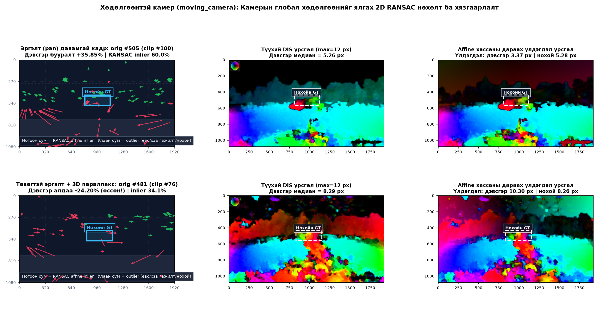
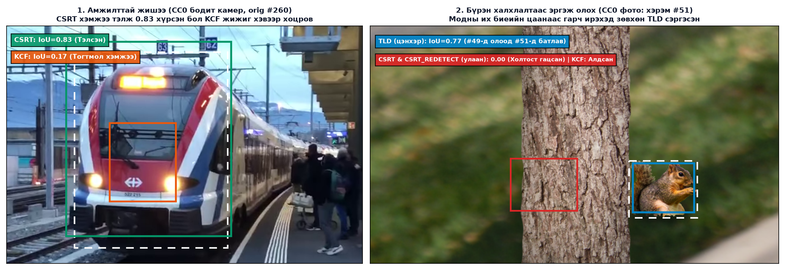
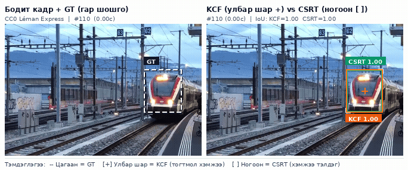

# Объект дагах ба оптик урсгал

OpenCV-ээр бодит бичлэг болон гэрэл зургаар үүсгэсэн дараалал дээр объект дагах найман аргыг харьцуулж, камерын хөдөлгөөний нөлөөг хэмжсэн. **Нохойны бичлэгт BOOSTING хамгийн өндөр оноо авсан. Тэрэг ойртоход CSRT хүрээгээ тэлсэн. Хэрэм далд ороод гарахад TLD түүнийг дахин олсон.**

## 1. Камер хөдөлж байхад нохойг дагаж чадах уу?

Бичлэгийн эхний кадарт нохойг гараар хүрээлнэ. Алгоритм дараагийн кадрт нохойны байрлалыг хайна. Олсон гэж үзвэл хүрээ гаргана. Үүнийг **объект дагах** гэдэг. Бичлэгийг бүрдүүлдэг нэг зураг нь **кадр**.


*Цагаан тасархай `GT` хүрээг гараар тэмдэглэсэн. Улбар шар нь BOOSTING, ногоон нь CSRT. 451-р кадрт BOOSTING-ийн хүрээний төв жишиг хүрээний төвөөс 199 пиксел (px), CSRT-ийнх 227 пиксел зүүн тийш зөрсөн.*

**IoU** нь хоёр хүрээ хэр давхцаж байгааг хэмждэг 0–1 оноо. Хоёр хүрээ нийлээд 100 нэгж талбай эзэлж, 60 нэгж нь давхцвал IoU **0.60**. Энэ туршилтад `IoU ≥ 0.50` бол тухайн кадрт объектыг амжилттай дагасан гэж тооцсон. [Нэр томьёоны тайлбар](#нэр-томьёоны-тайлбар)

Ижил анхны хүрээ, ижил 110 кадраар үнэлэхэд BOOSTING **0.5099**, анхны хүрээг хөдөлгөөгүй STATIC **0.4806**, CSRT **0.4695** дундаж IoU авсан. BOOSTING-ийн оноо STATIC-аас **0.0293**-аар илүү байв.

Дүрсийг репод байгаа дахин кодлосон MP4-өөс, хүрээг эх MP4 дээрх хэмжилтийн CSV-ээс авсан. [GIF үүсгэх код](make_three_videos_figures.py) · [Давтан хэмжилт](#нохойны-бичлэгийн-давтан-хэмжилт)

**Эх тайрдас `#405–#515`** · Эх 111 кадр · GIF 49 кадр · Үнэлсэн 110 кадр · [Бүтэн MP4](data/phone_videos/moving_camera.mp4) · [Гараар шошголсон хүрээ](results/csv/phone_moving_camera_gt.csv) · [BOOSTING](results/csv/track_moving_camera_BOOSTING.csv) · [CSRT](results/csv/track_moving_camera_CSRT.csv) · [Хэмжилтийн дүн](results/csv/phone_moving_camera_summary.csv)

Гурван GIF-д кадрыг эх бичлэгийн дугаараар тэмдэглэсэн. Дугаар 0-ээс эхэлнэ. [Нэгдсэн хэмжилт](results/csv/phone_videos_summary.csv) · [Эх дүрсний бүртгэл](NOTICE.md)

Камер эргэхэд нохойноос гадна өвс, мод ч хөдөлж харагдана. **Оптик урсгал** нь зургийн цэгүүд дараагийн кадрт хаашаа, хэр хол шилжсэнийг тооцно. Камерын ерөнхий шилжилтийг зураг дээрх цэгүүдээр тооцож (`FB-LK + RANSAC 2D affine`), `DIS_MEDIUM`-ээр гаргасан оптик урсгалаас хассан. Үүнийг **камерын хөдөлгөөний нөхөлт** гэдэг.

Нөхөлтийн дараа `#505`-д дэвсгэрийн медиан шилжилт **5.26-аас 3.37 px** болж **35.85% буурсан**. `#481`-д **8.29-өөс 10.30 px** болж **24.20% өссөн**. Энэ кадрт 2D загварт тохирсон цэгийн хувь 34.1% байсан. Камер хөдлөхөд ойрын өвс холын дэвсгэрээс өөр хэмжээгээр шилжиж харагддаг. Үүнийг **параллакс** гэдэг. Энэ ялгаа болон линзийн гажилт үр дүнд нөлөөлсөн байж болно. 28 хос кадрын медиан бууралт **13.62%**. [Кадр тус бүрийн хөдөлгөөний CSV](results/csv/phone_moving_camera_flow_pairs.csv) · [Нохой дагасан хүрээний CSV](results/csv/phone_moving_camera_summary.csv)



*Дээд мөрөнд нөхөлтийн дараа дэвсгэрийн урсгал багассан бол доод мөрөнд зүүн дээд хэсгийн үлдэгдэл урсгал нэмэгдсэн.*

## 2. Тэрэг ойртоход хүрээ нь дагаж томрох уу?


*Тэрэг ойртоход KCF-ийн улбар шар хүрээ 98 × 59 px хэвээр үлдэж, CSRT-ийн ногоон хүрээ сүүлийн кадрт 115 × 69 px болж тэлж байгааг ажиглаарай.*

**Эх тайрдас `#664–#721`** · Эх 58 кадр · GIF 27 кадр · Үнэлсэн 57 кадр · [Бүтэн MP4](data/phone_videos/stable.mp4) · [Гараар шошголсон хүрээ](results/csv/phone_stable_gt.csv) · [KCF](results/csv/track_stable_KCF.csv) · [CSRT](results/csv/track_stable_CSRT.csv) · [Хэмжилтийн дүн](results/csv/phone_stable_summary.csv)

`stable` бичлэгт жижиг тэрэгний тэмдэглэсэн хүрээ `98 × 59 px`-ээс `121 × 87 px` болж томорсон. CSRT **0.8505**, MEDIANFLOW **0.8267**, KCF **0.7213** дундаж IoU авсан. CSRT үнэлгээний **57/57** кадрт 0.50 босгыг хангав. Тогтмол хэмжээтэй KCF, BOOSTING, MIL-ийн хүрээ тэрэгний төв орчим үлдсэн ч томорсон дүрсийг бага хамарчээ. TLD-ийн хүрээ дээврийн хэсэгт хумигдаж, дундаж IoU **0.4070** болсон.


*Тэрэг томорсон тайрдаст CSRT болон CSRT_REDETECT ижил 0.8505 дундаж IoU авсныг баганан график харуулна.*

## 3. Алим шилний цаана сунаж харагдахад дагагч алдах уу?


*Алим тунгалаг хавтангийн цаагуур ороход дүрс нь сунаж гажиж, хавтангийн ирмэгээс гарахад буцаад дугуувтар болж байгааг ажиглаарай.*

**Эх тайрдас `#42–#235`** · Эх 194 кадр · GIF 89 кадр · Үнэлсэн 193 кадр · [Бүтэн MP4](data/phone_videos/occlusion.mp4) · [Гараар шошголсон хүрээ](results/csv/phone_occlusion_gt.csv) · [KCF](results/csv/track_occlusion_KCF.csv) · [CSRT](results/csv/track_occlusion_CSRT.csv) · [Хэмжилтийн дүн](results/csv/phone_occlusion_summary.csv)

Алим бүрэн алга болоогүй (`absent_frames = 0`). CSRT, CSRT_REDETECT хоёр **193/193** кадрт босгыг хангасан. KCF **0.7190** дундаж IoU-аар тэргүүлж, **191/193** кадрт босгыг хангасан. Алим шилний цаанаас гарснаас 31 кадрын дараа MIL-ийн IoU ≥ 0.50 болсон гурван кадрын цуваа эхэлсэн. Сэргэлт 33 кадрын дараа буюу цувааны гурав дахь кадрт батлагдсан.


*Алим шилний цаана байх хоёр хэсгийг сүүдэрлэсэн бөгөөд CSRT-ийн шугам 0.50 босгоос доош ороогүй.*

## 4. Хэрэм модны цаанаас гарахад дагагч эргэж олох уу?

Хэрэм модны цаана ороход далд болж байна. Үүнийг **халхлалт** гэдэг. Буцаж гарсны дараа алгоритм хэрмийг дахин хүрээлж чадвал дагалт **сэргэсэн** гэж үзнэ.

Дарааллыг хоёр CC0 гэрэл зургаар үүсгэсэн. Хэрмийн дүрсэд харьяалагдах пикселүүдийг ялгасныг **маск** гэж нэрлэнэ. Харагдах масканд 25-аас цөөн пиксел үлдвэл кадрыг далд гэж үнэлсэн. `#28`-д маскны 0.05% харагдсан. `#29–#36`-д харагдах пиксел 0 болж, `#37`-д хэрэм дахин гарч ирсэн. Нийт **66 кадр**, GIF-ийн урт **5.50 сек**. [Кадрын шошго](results/csv/squirrel_occlusion_gt.csv) · [Фотоны эх сурвалж](NOTICE.md)


*KCF далд үед хүрээ гаргаагүй бөгөөд хэрмийг эргэж олоогүй, харин TLD буруу хүрээ гаргасан ч #49-д IoU 0.7535 хүрч #51-д сэргэлтийн шалгуурыг хангасан.*


*Хэрэм буцаж гарсан #51-д TLD хэрэм дээр, CSRT-ийн хүрээ модны их бие дээр байна.*

Сэргэлтийг IoU ≥ 0.50 гурван кадр дараалан хангаснаар баталгаажуулсан. `first` нь тэр гурван кадрын эхнийх, `confirmed` нь гурав дахь нь. Хоёуланг нь хэрэм буцаж гарсан `#37`-оос тоолсон.

| Алгоритм | Mean IoU | IoU ≥ 0.50 | Failure % | Далд кадрын FP (`9` кадр) | Сэргэлт (`first/confirmed`) | Algo FPS |
| :--- | :---: | :---: | :---: | :---: | :---: | :---: |
| **`TLD`** | **0.5131** | **66.07%** | 0.00% | 9 / 9 (`100%`) | **`12 / 14` (`#49 / #51`)** | 49.15 |
| `MEDIANFLOW` | 0.3672 | 37.50% | 0.00% | 9 / 9 (`100%`) | Эргэж олоогүй | **1259.15** |
| `MIL` | 0.3543 | 35.71% | 0.00% | 9 / 9 (`100%`) | Эргэж олоогүй | 52.40 |
| `CSRT` / `CSRT_REDETECT` | 0.3533 | 35.71% | 0.00% | 9 / 9 (`100%`), `redet=0` | Эргэж олоогүй | 54.03 / 53.10 |
| `BOOSTING` | 0.3415 | 35.71% | 0.00% | 9 / 9 (`100%`) | Эргэж олоогүй | 46.65 |
| **`KCF`** | 0.3043 | 35.71% | 60.71% | **`0 / 9` (`0.00%`)** | Эргэж олоогүй | 827.39 |
| `STATIC` *(суурь)* | 0.0862 | 7.14% | 0.00% | 9 / 9 (`100%`) | Эргэж олоогүй | *(хассан)* |

## Арга, хэмжилтийн нөхцөл

- **Даалгаврын давталт.** `06-Tracking-APIs.ipynb - Colaboratory.pdf`-ийн 1–2-р хуудасны BOOSTING, MIL, KCF, TLD, MEDIANFLOW дагагчийг OpenCV 4.14.0 болон 5.0.0-ийн API-тай тулгасан. `06-Optical-Flow.ipynb - Colaboratory.pdf`-ийн 1–3-р хуудасны Shi–Tomasi + Lucas–Kanade (`winSize=200×200`) болон Farnebäck-ийн HSV дүрслэлийг давтсан. [Давтах скрипт](reproduce_pdf.py) · [OpenCV API шалгалт](results/csv/tracker_bindings_cv414.csv) · [Вебкамерын 12/12 кадрын шалгалт](results/csv/webcam_smoke.csv)
- **Объект дагах.** Бичлэгийн нэг ижил кадрын муж, анхны хүрээг бүх аргад өгсөн. Анхны кадрыг оноонд оруулаагүй. KCF ба CSRT объектын дүрсийг корреляцийн шүүлтүүрээр хайдаг. BOOSTING ба MIL эргэн тойрны хүрээнүүдийг ялгаж сурах загвараа шинэчилдэг. MEDIANFLOW цэгийн хөдөлгөөн ашигладаг. TLD дагах болон дахин илрүүлэх шаттай. CSRT_REDETECT нь алдагдлын дохиогоор загварыг дахин хайдаг. STATIC туршилт анхны хүрээг хөдөлгөхгүй барьдаг суурь арга. [Дагагчийн код](trackers.py) · [Үнэлгээний код](benchmark_track.py)
- **Оптик урсгал.** Lucas–Kanade сонгосон цэгүүдийг, Farnebäck ба DIS дүрсний нягт хөдөлгөөнийг тооцно. Хөдөлгөөний бодит векторын шошготой өгөгдөлд таамагласан болон бодит векторын төгсгөлийн зөрүүг EPE-ээр (пиксел) хэмжсэн. Гурван нэмэлт бичлэгт урсгалын шошго байхгүй тул камерын нөхөлтийн өмнөх ба дараах дэвсгэрийн шилжилтийг харьцуулсан. [Оптик урсгалын код](benchmark_flow.py)

| Бодит векторын шошготой хос | Farnebäck EPE (px) | DIS_MEDIUM EPE (px) |
| --- | ---: | ---: |
| Middlebury RubberWhale | 0.3612 | 0.2258 |
| Middlebury Grove2 | 0.5852 | 0.3189 |
| MPI Sintel alley_1 clean | 0.8406 | 0.2581 |
| MPI Sintel ambush_5 final | 4.1480 | 2.4601 |

Энд бүх хүчинтэй пикселийн дундаж EPE-г харьцуулсан. [Бүрэн EPE хүснэгт](results/csv/flow_summary.csv) · [Харьцуулсан график](results/figures/flow_error_and_dis_cc0.png)

### Нэр томьёоны тайлбар

| Үг | Энэ тайланд ямар утгатай вэ? |
| --- | --- |
| **Tracker** буюу дагагч | Дараагийн кадрт биет хаана байгааг таамаглаж, тэгш өнцөгт хүрээ гаргадаг алгоритм. BOOSTING, KCF, CSRT зэрэг нь дагагчийн нэр. |
| **GT** (*ground truth*) | Үнэлгээнд жишиг болсон хүрээ. Бодит бичлэгт гараар тэмдэглэсэн, хэрмийн хяналттай дараалалд харагдах хэсгийн маскнаас тооцсон. |
| **Mean IoU** | Үнэлсэн кадруудын хүрээний давхцлын дундаж. Хүснэгтийн `IoU ≥ 0.50 (%)` багана нь босгыг хангасан кадрын хувь. |
| **px**, **EPE** | `px` нь пикселийн нэгж. **EPE** нь тухайн цэгийн таамагласан ба жишиг шилжилтийн сумны үзүүр хоорондын зай. Пикселээр хэмжинэ. |
| **FP**, **Failure %**, **Drift** | FP нь биетийг далд гэж үнэлсэн кадрт гарсан буруу хүрээ. Failure % нь биет харагдаж байхад хүчинтэй хүрээ гараагүй хувь. Drift нь дагагч хүрээ гаргасан ч IoU нь 0.20-оос бага болсон кадрын тоо. |
| **FPS**, **Algo**, **E2E** | FPS нь секундэд ногдох кадрын тоо. GIF-д тоглуулах хурдыг, хэмжилтэд боловсруулах хурдыг заана. Algo нь дагагчийн тооцооны хугацаа. E2E нь бэлэн кадр унших, дагагчийг ажиллуулах, хүрээ зурах, гаралтын MP4 бичих хугацааг хамарна. |
| **CSV** | Хэмжилтийг мөр, баганаар хадгалсан хүснэгтийн файл. Кадр бүрийн утгыг тэндээс шалгаж болно. |

## Дүгнэлт ба хязгаарлалт



*Зүүн талд галт тэрэгний #260-д CSRT 0.83, KCF 0.17 IoU авсан, баруун талд хэрмийн #51-д TLD 0.77 хүрэхэд CSRT-ийн хүрээ холтос дээр үлдсэн.*

Хэрмийн туршилт объектоо алдсанаа мэдэх ба эргэж олох хоёр тусдаа чадвар болохыг харуулсан. Энд CSRT_REDETECT-ийн дахин хайлт огт асаагүй. Өмнөх хяналттай дугуйн туршилтад CSRT_REDETECT дахин олж чадсан, LaSOT-ийн `bicycle-11`-д сэргээгүй. Халхлалтын 3, 11, 22 кадрын туршилтын 11 кадртай төөрөгдүүлэгч бүхий хувилбарт TLD 31 кадрт төстэй объектыг андуурсан. Эдгээр үр дүнг тайрдас бүрийн нөхцөлд тайлбарлав. [Дугуйн туршилт](results/csv/track_summary.csv) · [Халхлалтын шатлал](results/csv/track_occlusion_ladder.csv) · [LaSOT хэмжилт](results/csv/track_generalization_lasot.csv)

## Нэмэлт туршилт · Léman Express галт тэрэг



*Галт тэрэг ойртоход KCF-ийн улбар шар хүрээ ижил хэмжээтэй үлдэж, CSRT-ийн ногоон хүрээ галт тэрэгтэй хамт тэлж байна.*

`1280 × 720`, 30 FPS эх бичлэгийн `#110–#260` мужийн 151 кадраас эхний кадрыг хасаж үнэлсэн. Дундаж IoU нь KCF-д **0.4400**, CSRT-д **0.7767** байв. Сүүлчийн кадарт KCF **0.17**, CSRT **0.83** IoU авсан. `684 × 285`, 10 FPS GIF-ийн урт 5.10 сек. Эх бичлэгийг `Thibaut120094` авсан бөгөөд `CC0 1.0` лицензтэй. [Галт тэрэгний хэмжилт](results/csv/phone_commons_leman_express_summary.csv) · [Хөдөлгөөнгүй гол кадрууд](results/figures/custom_videos/tracking_demo_keyframes.png) · [Wikimedia Commons](https://commons.wikimedia.org/wiki/File:Arriv%C3%A9e_en_gare_du_L%C3%A9man_Express_pour_Coppet_(2019-12-16).webm)

`#246`-д `DIS_MEDIUM`-ийн дэвсгэрийн хөдөлгөөн 3.56-аас 0.36 px болж 89.98% буурсан. 38 хос кадрын медиан бууралт 74.91%. [Галт тэрэгний урсгалын CSV](results/csv/phone_commons_leman_express_flow_pairs.csv)

| Tracker | Mean IoU | IoU ≥ 0.50 (%) | Failure % | Algo ms (FPS) | E2E ms (FPS) |
| :--- | :---: | :---: | :---: | :---: | :---: |
| **`MEDIANFLOW`** | **0.7851** | **100.00%** | 0.0% | 2.09 (477.81) | 10.16 (98.46) |
| **`CSRT`** | **0.7767** | **100.00%** | 0.0% | 27.37 (36.53) | 37.38 (26.75) |
| **`CSRT_REDETECT`** | **0.7767** | **100.00%** | 0.0% | 27.68 (36.13) | 37.79 (26.46) |
| `TLD` | 0.4595 | 32.00% | 0.0% | 56.88 (17.58) | 60.87 (16.43) |
| `MIL` | 0.4401 | 34.00% | 0.0% | 18.45 (54.20) | 27.68 (36.13) |
| **`KCF`** | **0.4400** | **34.00%** | 0.0% | 3.49 (286.41) | 18.69 (53.50) |
| `BOOSTING` | 0.4327 | 31.33% | 0.0% | 32.59 (30.68) | 41.76 (23.95) |
| `STATIC` *(суурь)* | 0.2870 | 22.67% | 0.0% | — | 8.11 (123.29) |

<details>
<summary>Гурван үндсэн бичлэгийн дэлгэрэнгүй хэмжилт</summary>

**Гурван үндсэн бичлэг.** Хугацааг CPU-ийн нэг урсгал дээр хэмжсэн. **E2E FPS**-д урьдчилж задалсан JPEG кадр унших, дагагчийг ажиллуулах, хүрээ зурах, үр дүнг MP4-д бичих хугацаа орсон. Эх MP4-ийг JPEG кадр болгон задлах ажлыг хэмжилтээс өмнө хийсэн. STATIC-ийн хувьд E2E FPS-ийг тайлагнасан. [Нэгдсэн CSV](results/csv/phone_videos_summary.csv)

| Бичлэг | Tracker | Mean IoU | IoU ≥ 0.50 (%) | Failure % | Drift (`IoU<0.2`) | Сэргэлт (`first/conf`) | Algo FPS | E2E FPS |
| :--- | :--- | :---: | :---: | :---: | :---: | :---: | :---: | :---: |
| `stable` | **`CSRT`** / **`CSRT_REDETECT`** | **0.8505** | **100.00%** | 0.0% | 0 | — | 53.78 / 50.68 | 35.08 / 35.35 |
| `stable` | `MEDIANFLOW` | 0.8267 | 100.00% | 0.0% | 0 | — | 192.88 | 71.41 |
| `stable` | `MIL` / `BOOSTING` / `KCF` | 0.7316 / 0.7268 / 0.7213 | 100.00% | 0.0% | 0 | — | 35.3–139.0 | 32.5–40.0 |
| `stable` | `TLD` | 0.4070 | 26.32% | 0.0% | 0 | — | 15.48 | 12.91 |
| `stable` | `STATIC` *(суурь)* | 0.0917 | 7.02% | 0.0% | 48 | — | *(хассан)* | 119.68 |
| `moving_camera` | **`BOOSTING`** | **0.5099** | **57.27%** | 0.0% | 1 | — | 46.72 | 24.72 |
| `moving_camera` | `STATIC` *(суурь)* | 0.4806 | 41.82% | 0.0% | 0 | — | *(хассан)* | 56.47 |
| `moving_camera` | `CSRT` / `CSRT_REDETECT` | 0.4695 | 40.00% | 0.0% | 1 | — | 25.58 / 25.07 | 15.83 / 15.65 |
| `moving_camera` | `KCF` | 0.3888 | 22.73% | 12.73% | 1 | — | 33.23 | 15.44 |
| `moving_camera` | `TLD` / `MIL` / `MEDIANFLOW` | 0.3168 / 0.2088 / 0.1180 | 32.73 / 9.09 / 3.64% | 0.0% | 46 / 70 / 88 | — | 18.2–206.1 | 14.0–43.7 |
| `occlusion` | **`KCF`** | **0.7190** | 98.96% | 0.0% | 0 | Шилний дараа `≥0.5` (`#131/133`) | 68.88 | 35.73 |
| `occlusion` | **`CSRT`** / **`CSRT_REDETECT`** | **0.6225** | **100.00%** | 0.0% | 0 | **Тасралтгүй (`193/193`)** | 33.92 / 33.21 | 25.32 / 24.91 |
| `occlusion` | `BOOSTING` | 0.6395 | 94.82% | 0.0% | 0 | Шилний дараа `≥0.5` (`#131/133`) | 35.67 | 28.73 |
| `occlusion` | `MIL` | 0.4187 | 34.20% | 0.0% | 0 | 31 / 33 (`162/164`) | 54.03 | 39.58 |
| `occlusion` | `MEDIANFLOW` | 0.3099 | 41.97% | 18.13% | 63 | Эргэж олоогүй | 500.86 | 114.63 |
| `occlusion` | `TLD` | 0.3058 | 5.18% | 0.0% | 23 | Эргэж олоогүй | 16.70 | 15.02 |
| `occlusion` | `STATIC` *(суурь)* | 0.2695 | 23.83% | 0.0% | 126 | 22 / 24 (`153/155`) | *(хассан)* | 149.65 |

</details>

## Ажиллуулах

Linux дээр төслийн үндсэн хавтаснаас ажиллуул. Нийтэлсэн хэмжилтийн орчин нь Intel Core 5 120U, нэг CPU урсгал, Python 3.14.4, `opencv-contrib-python==4.14.0.94`, FFmpeg 8.0.1. GIF үүсгэхэд `ffmpeg`, DejaVu Sans фонтууд хэрэгтэй. Эх файл татах команд `curl` ашиглана.

```bash
python3 -m venv .venv
source .venv/bin/activate
python -m pip install -r requirements.txt
```

### Галт тэрэгний хэмжилтийг давтах

```bash
mkdir -p data/commons
curl -fL -o data/commons/leman_express_cc0.webm \
  'https://upload.wikimedia.org/wikipedia/commons/9/9b/Arriv%C3%A9e_en_gare_du_L%C3%A9man_Express_pour_Coppet_%282019-12-16%29.webm'

python custom_video_lab.py --evaluate data/commons/leman_express_cc0.webm \
  --gt results/csv/commons_leman_express_gt.csv --start-frame 110 --end-frame 260 --seq-id commons_leman_express
```

Үндсэн гаралт нь `results/csv/phone_commons_leman_express_summary.csv`. Кадр тус бүрийн хүрээ `results/csv/track_commons_leman_express_*.csv`, урсгалын хэмжилт `results/csv/phone_commons_leman_express_flow_pairs.csv`-д үүснэ.

### Хэрмийн GIF-ийг үүсгэх

Гэрэл зургуудыг скрипт татаж, хяналттай дараалал болон шошгыг үүсгэнэ.

```bash
python squirrel_occlusion_lab.py --rebuild-seq
python make_three_videos_figures.py --only-squirrel
python -m unittest discover -s tests -v
```

Хэмжилт `results/csv/squirrel_occlusion_summary.csv`-д, `squirrel_occlusion.gif` ба `squirrel_occlusion_keyframes.png` нь `results/figures/custom_videos/`-д үүснэ.

### PDF-ийн давталт ба бүтэн туршилт

Гурван бүтэн MP4 нь `data/phone_videos/` дотор `stable.mp4`, `moving_camera.mp4`, `occlusion.mp4` нэрээр байна. GIF үүсгэх команд эдгээр MP4, `results/csv/phone_*_gt.csv`, `results/csv/track_*.csv` файлуудыг уншиж `results/figures/custom_videos/tracking_{stable,moving_camera,occlusion}.gif` үүсгэнэ. GIF-үүд эхний, гол болон сүүлийн кадрыг багтааж, секундэд ойролцоогоор 11 кадраар тоглоно. Бүх зургийг дахин үүсгэх бол дээрх галт тэрэг, хэрмийн туршилтыг түрүүлж ажиллуул. [Эх өгөгдөл ба лицензийн бүртгэл](NOTICE.md)

```bash
python make_three_videos_figures.py --phone-gifs
```

```bash
python dataset_prep.py --all
python reproduce_pdf.py --mode all-pdf --no-show
python benchmark_flow.py && python benchmark_track.py
```

Репод байгаа `data/phone_videos/moving_camera.mp4` нь бүтэн 91.960 секунд, 2,299 кадр, 25 FPS болон кадр бүрийн хугацааны тэмдэглэгээг хадгалж дахин кодлосон хувилбар. Энэ файлаар туршилтыг ажиллуулж болно. Өмнөх CSV-ийн дүнг яг тулгахдаа тусдаа ажлын хуулбар ашиглаж, тэндхийн `data/phone_videos/moving_camera.mp4` замд хэмжилтэд ашигласан эх MP4-ийг байрлуул. Хоёр файлын SHA-256 тусдаа бүртгэлтэй. [Эх MP4 ба репогийн хувилбарын SHA-256](NOTICE.md)

```bash
python custom_video_lab.py --run-three
python make_figure.py && python make_three_videos_figures.py
python make_three_videos_figures.py --phone-gifs
```

PDF-ийн давталтын бичлэг `results/videos/pdf_replay_*.mp4`-д, хэмжилт `results/csv/`-д, тайлангийн зураг `results/figures/`-д үүснэ.

#### Нохойны бичлэгийн давтан хэмжилт

Тусдаа ажлын хавтаст OpenCV 4.14.0-өөр ижил анхны хүрээ, ижил 110 үнэлгээний кадр ашиглан гурван аргын дундаж IoU-г дахин хэмжив. Арга бүрийг файл тус бүр дээр нэг удаа ажиллуулсан.

| Арга | Эх MP4 | Репод байгаа дахин кодлосон MP4 |
| --- | ---: | ---: |
| STATIC | 0.4806 | 0.4806 |
| BOOSTING | 0.5099 | 0.5090 |
| CSRT | 0.4695 | 0.5625 |

Энэ давталтад эх MP4 дээр BOOSTING, дахин кодлосон MP4 дээр CSRT хамгийн өндөр дундаж IoU авсан.

[Тохиргоо](config.py) · [Хэмжүүрийн тооцоо](metrics.py) · [Өгөгдөл бэлтгэх код](dataset_prep.py) · [Зураг үүсгэх код](make_three_videos_figures.py) · [Тестүүд](tests/test_metrics_and_pipeline.py) · [Суурь туршилтын график](results/figures/tracking_flow_metrics.png) · [Word тайлан үүсгэх код](build_report.py)
