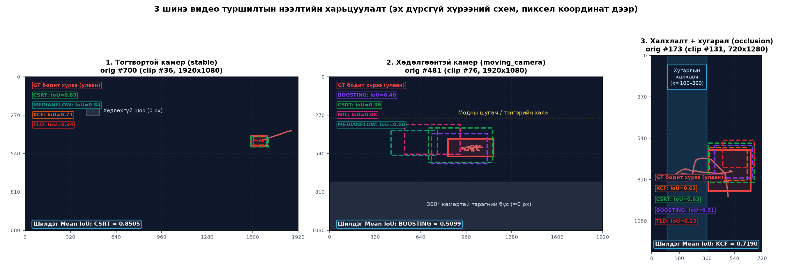
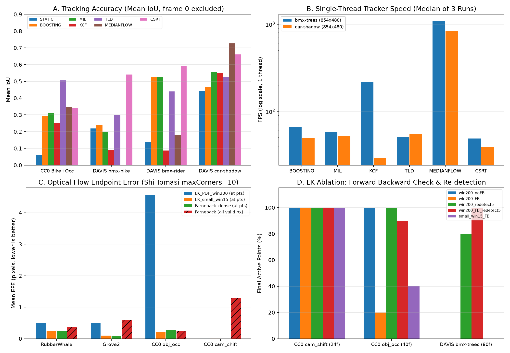
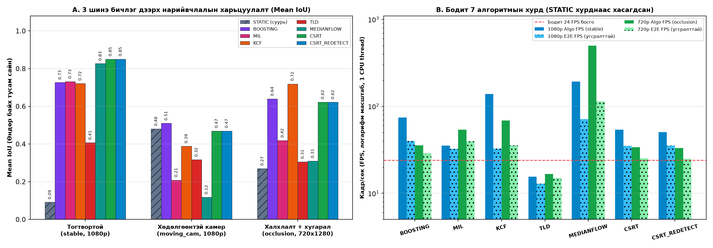
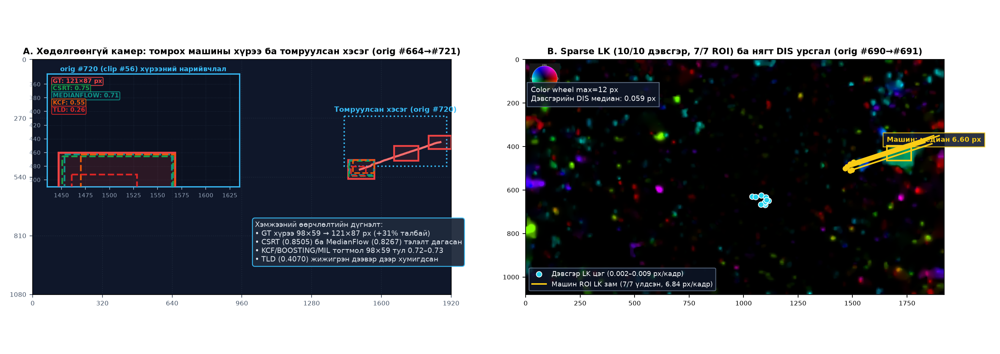
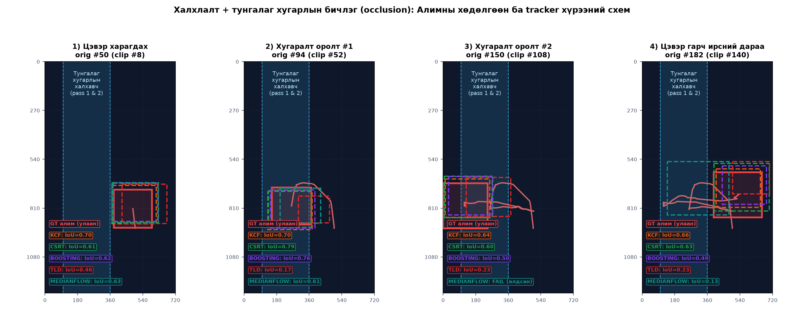
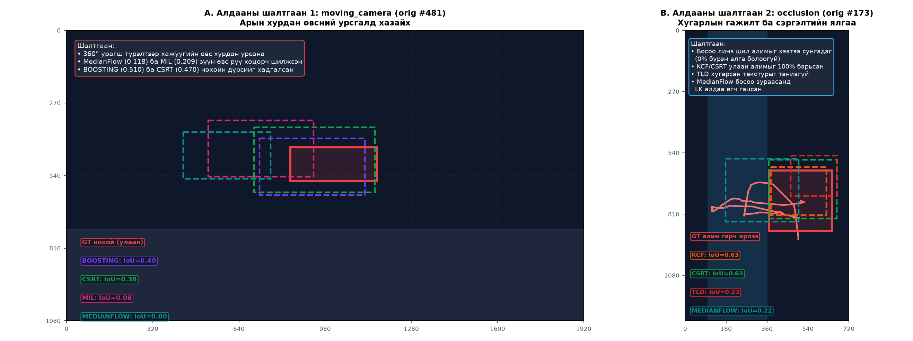

# Объект дагах ба Optical Flow лаборатори (`cv-tracking-optical-flow-lab`)

> Энэхүү тайлан нь компьютер харааны **объект дагах (Visual Object Tracking)** болон **оптик урсгал (Optical Flow)** алгоритмуудыг сургалтын PDF-ээс бодитоор давтаж, нийтийн стандарт өгөгдөл болон **шинэ 3 бодит видео бичлэг (`stable`, `moving_camera`, `occlusion`)** дээр ижил нөхцөлөөр хэмжсэн **бүрэн лабораторийн тайлан** юм. Компьютер харааны сэдвийг анх удаа үзэж буй уншигч ч эхнээс нь дарааллаар уншаад зорилго, арга, тоон үр дүн, хязгаарлалтыг ойлгохуйц байдлаар бичигдсэн.

---

## Товч хураангуй (Executive Summary)

1. **Яагаад нэг алгоритм бүх нөхцөлд төгс биш вэ?** Камер хөдөлгөөнгүй, объект хэмжээ нь тэлдэг орчинд (`stable`) `CSRT` (`Mean IoU = 0.8505`) болон `MEDIANFLOW` (`0.8267`) хамгийн өндөр нарийвчлалтай байсан ч, камер өөрөө огцом эргэх, 3D дэвсгэр хурдан урсах үед (`moving_camera`) `MEDIANFLOW` дэвсгэрийн хөдөлгөөнд татагдан `0.1180` болж унасан бол `BOOSTING` (`0.5099`) болон `CSRT` (`0.4695`) зорилтот нохойг хадгалж үлджээ.
2. **Тунгалаг хугаралт vs бүрэн халхлалт:** `occlusion` бичлэгийн алим босоо линз хавтангийн цаагуур 2 удаа өнгөрөхөд дүрс 0% бүрэн алга болоогүй харин хэвтээ сунаж хугарсан (`absent_frames = 0`). Үүнд `KCF` (`0.7190`), `BOOSTING` (`0.6395`), `CSRT` (`0.6225`) тасралтгүй (`100%` амжилт `CSRT`-ээр) дагаж **0 кадр алдагдалгүй** сэргэсэн бол `TLD` (`5.18%`) болон `MEDIANFLOW` (`fail = 18.13%`) шилний дараа эргэж олоогүй. Эсрэгээр, бүрэн халхлагддаг (`ctrl_bicycle_occ`, `absent = 5` кадр) нөхцөлд энгийн `CSRT` сэргэж чадахгүй унадаг тул манай **`CSRTReDetectTracker` (`CSRT_REDETECT`)** шийдэл (`Mean IoU: 0.3402 → 0.5861`) зайлшгүй шаардлагатайг хоёр туршилт харилцан баталгаажууллаа.
3. **Optical Flow хурд ба камерын хөдөлгөөн ялгалт:** Өмнөх `Middlebury` болон `MPI Sintel` дээр `DIS_MEDIUM` (`EPE 0.226–0.319 px`) нь `Farnebäck`-ээс (`0.361–0.585 px`) илүү нарийвчлалтай, харин `DIS_FAST` / `DIS_ULTRAFAST` нь `123–256 FPS` хурдтай гарсан. Шинэ `moving_camera` дээр `FB-LK + RANSAC 2D affine` нөхөлт эргэлт давамгай кадруудад (`orig #505`) дэвсгэрийн хөдөлгөөнийг **35.85%** бууруулсан ч, `360°` линзийн муруйлт + ойрын өвсний 3D параллакс давамгайлсан кадрт (`orig #481`) 2D хавтгай загвар хүрэлцэхгүй тул үлдэгдэл алдаа **-24.20%** болж эсрэгээрээ өссөн байна.


*Зураг 1. Гурван шинэ видео туршилтын гол мөчүүдийг харуулсан нээлтийн схем (`stable` orig #700, `moving_camera` orig #481, `occlusion` orig #173). Нийтлэх эрх нь тодорхойгүй гаднын видеоны түүхий дүрсний оронд бодит хэмжилтийн хүрээ, замнал, IoU утгыг эх дүрсгүй координатын хавтгайд дүрслэв.*

---

## 1. Зорилго ба анхан шатны үндсэн ойлголт

Компьютер харааны видео шинжилгээнд бид ихэвчлэн хоёр үндсэн бодлогыг шийддэг:
- **Объект дагах (Visual Object Tracking):** Эхний кадрт хэрэглэгчийн заасан нэг биетийг дараагийн кадруудад тэгш өнцөгт хүрээгээр тасралтгүй дагаж, байрлал болон хэмжээг нь шинэчлэх.
- **Оптик урсгал (Optical Flow):** Дараалсан хоёр кадрын хооронд цэг эсвэл пиксел бүр хаашаа, хэдэн пиксел шилжсэнийг хурдны вектороор (`dx, dy`) тооцоолох. **Sparse optical flow** (`Shi–Tomasi + Lucas–Kanade`) нь зөвхөн онцлог булангийн цөөн цэгүүдийг дагадаг бол **Dense optical flow** (`Farnebäck`, `DIS`) нь зургийн **бүх пикселийн** хөдөлгөөний талбайг гаргадаг.

### Түлхүүр нэр томьёо (анх уншиж буй хүнд)
- **Кадр (Frame) ба FPS (Frames Per Second):** Видео нь секунд тутамд дараалан гарах хөдөлгөөнгүй зургуудаас тогтоно (жишээ нь 24 FPS гэдэг нь 1 секундэд 24 зураг). Бид туршилтад зөвхөн алгоритмын цэвэр тооцооллын **`Algo FPS`** болон зураг унших, дүрслэх угсралтыг оролцуулсан **`E2E (End-to-End) FPS`**-ийг 1 CPU урсгал (`1 thread`) дээр тусад нь хэмжсэн.
- **Bounding Box (`bbox`):** Объектыг багтаасан тэгш өнцөгт хүрээ `(x, y, өргөн, өндөр)`.
- **Ground Truth (`GT`):** Хүн эсвэл тусгай датасетийн тэмдэглэсэн *бодит жишиг* байрлал.
- **Алдаа гажих (`Drift`) ба далд оролт (`Occlusion`):** Tracker зорилтот объектаа орхиж арын дэвсгэр дээр наалдаж үлдэхийг *drift*, өөр биетийн цаагуур орж халхлагдахыг *occlusion* гэнэ.
- **Суурь жишиг (`STATIC Baseline`):** Хүрээгээ огт хөдөлгөхгүйгээр анхны байрлалд хэвээр үлдээдэг хийсвэр харьцуулалт. Энэ нь алгоритм "огт хөдөлгөөгүй ч хэр их IoU гарах байсан бэ" гэдгийг шалгах жишиг болохоос жинхэнэ tracker биш тул **хурдны эрэмбэлэлтээс хассан**.

### Нарийвчлалын гол хэмжүүрүүд: IoU ба EPE

1. **IoU (Intersection over Union — Давхцлын харьцаа):** Бодит `GT` хүрээ ба алгоритмын зурсан хүрээ хоёр хэр давхцаж байгааг `0.0` (огт давхцаагүй) – `1.0` (яг ижил) хооронд хэмжинэ:

$$\text{IoU} = \frac{\text{Давхцсан талбай (Intersection)}}{\text{Нийлбэр талбай (Union)}}$$

> **Энгийн тоон жишээ:** `GT` хүрээ ба алгоритмын хүрээ тус бүр `80` пиксел талбайтай, тэдгээрийн давхцсан хэсэг нь `60` пиксел байвал нийлбэр талбай `80 + 80 - 60 = 100` болно. Тэгвэл $\text{IoU} = 60 / 100 = 0.60$. Энэ лабораторид **IoU ≥ 0.50** бол тухайн кадрыг амжилттай дагасанд тооцов.

2. **EPE (End-Point Error — Пикселийн төгсгөлийн цэгийн алдаа):** Optical flow-ийн таамагласан `(u, v)` вектор бодит `(u_gt, v_gt)` вектороос хэдэн пиксел зөрсөнийг хэмжинэ:

$$\text{EPE} = \sqrt{(u - u_{\text{gt}})^2 + (v - v_{\text{gt}})^2}$$

> **Анхаар (Бодит Flow GT-ийн ялгаа):** `Middlebury`, `MPI Sintel`, болон CC0 шилжилтийн хосууд дээр пиксел бүрийн бодит `.flo` GT байгаа тул жинхэнэ **EPE** бодогдоно. Харин энгийн MP4 камерын **шинэ 3 бичлэг (`stable`, `moving_camera`, `occlusion`) дээр пикселийн `.flo` GT байхгүй** тул зохиомол EPE бичихгүйгээр цэгийн ID хадгалалт (`retention %`), урагш-хойш шалгалтын (`Forward-Backward`) тогтвортой байдал, медиан хурд (`px/кадр`), дэвсгэр vs объектын ялгарал болон `RANSAC` нөхөлтийн бууралтаар хэмжсэн.

---

## 2. Өгөгдөл, сургалтын PDF давталт ба туршилтын аргачлал

### 2.1. Сургалтын PDF-ийн үндсэн давталт ба OpenCV API шалгалт
Хэрэглэгчийн өгсөн хоёр сургалтын PDF-ийн бүх туршилтыг GUI цонхгүйгээр давтаж ажиллуулдаг (`reproduce_pdf.py`), физик вебкамер байвал `/dev/video0` дээр богино `smoke run` (`webcam_smoke.csv`: `12/12` амжилттай) хийдэг болгосон:
- **`06-Tracking-APIs.ipynb - Colaboratory.pdf` (х. 1–2):** `BOOSTING`, `MIL`, `KCF`, `TLD`, `MEDIANFLOW`-ийг анхны `ROI`-оор эхлүүлэн кадр бүрээр шалгаж MP4/CSV гаргасан.
- **`06-Optical-Flow.ipynb - Colaboratory.pdf` (х. 1–3):** `Shi–Tomasi (maxCorners=10)` + `pyramidal Lucas–Kanade (winSize=200x200)` цэгийн замнал болон `Farnebäck` dense flow-ийн `HSV` өнгөт дүрслэлийг (дээд хязгаар `12 px` тогтмол масштаб + өнгөний дугуй/color wheel) давтав.
- **OpenCV binding бодит шалгалт (`tracker_binding_check.py`, `tracker_bindings_cv414.csv`, `tracker_bindings_cv500.csv`):** Суулгасан `opencv-contrib-python==4.14.0.94` болон `5.0.0.93` дээр `BOOSTING`, `TLD`, `MEDIANFLOW`, `MOSSE` нь `cv2.*` биш `cv2.legacy.Tracker*_create` дотор байрладаг; мөн `cv2.TrackerMIL/KCF/CSRT.init()` нь Python дээр `True` биш **`None`** буцаадаг тул `if not ok:` гэж шалгавал буруу унах асуудлыг `safe_tracker_init()` helper-ээр бүрэн зассан.

### 2.2. Нийтийн жишиг өгөгдлүүд (Өмнөх суурь туршилтууд)
- **CC0 хяналттай шат (`Wikimedia Commons Front_Side_of_Bicyle.jpg`, CC0 1.0):** Бодит `0%–100%` халхлалтын шат (`ctrl_bicycle_occ`, `ctrl_occ_ladder_3f/10f/20f`, дистрактор `10f_distractor`), камер шилжилт (`ctrl_bicycle_cam_shift`), болон `.flo` GT бүхий урсгалын хосууд (`obj_occ`, `cam_shift`, `cam_plus_obj`). Нийтлэх эрх чөлөөтэй тул зураг ба демо MP4 нь GitHub-д хавсаргагдсан.
- **DAVIS 2017 (`CC BY-NC 4.0`) & LaSOT (`bicycle-11`):** `bmx-trees` (хоёр зорилт: дугуй/унаач, модны хүнд халхлалт), `car-shadow`, `scooter-black`, болон бүрэн алга болдог `lasot_bicycle11` (`120` кадр, бүрэн халхлалт `#74–78`).
- **Middlebury (`RubberWhale`, `Grove2`) & MPI Sintel (`alley_1 clean`, `ambush_5 final`):** Жинхэнэ `.flo` болон occluded/invalid маск бүхий оптик урсгалын жишиг.

### 2.3. Хэрэглэгчийн бэлдсэн 3 шинэ бичлэгийн бүртгэл

Гурван MP4 файлыг `/home/jinlight/Documents/TDB/` дотор эх нэрээр нь хэвээр хадгалж `data/phone_videos/`-руу symlink холбосон. Контейнерийн метадата нь гурвуулаа `ISO Media file produced by Google Inc.` (`DASH`) тул нийтлэх лиценз нь тодорхойгүй гаднын видеоны эх файл болон түүхий RGB кадруудыг `.gitignore`-ээр GitHub-аас хамгаалж (`*.mp4`, `results/local_only/`), оронд нь үнэн кодын үр дүнгээс үүссэн график болон эх дүрсгүй схемүүдийг (`results/figures/custom_videos/`) нийтлэв.

Эхний болон гол үнэлгээнээс **өмнө** кадр хоорондын ялгаа ба харааны шалгалтаар **тасралтгүй, таслалтгүй (cut-free) кадрын мужийг** сонгон түгжсэн:

| Туршилтын ID | Эх файлын нэр & SHA-256 эхлэл | Нягтрал, FPS, Эх урт | Сонгосон тайрдас (урт) | Дагасан объект ба үзэгдэл | Камер ба эх үүсвэрийн төлөв |
| :--- | :--- | :--- | :--- | :--- | :--- |
| **`stable`** | `Тогтвортой камертай жишээ.mp4` (`77e5daee...`) | `1920×1080`, `23.976 fps`, 2328 кадр (97.10с) | `orig #664–#721` (**58 кадр**, 2.42с) | Баруунаас зүүн төврүү хурдасч томордог хар жижиг тэрэг (`98×59 → 121×87 px`) | **Түгжээтэй хөдөлгөөнгүй камер** (сурталчилгааны студийн хэсэг; `absent=0`, гаднын DASH эх сурвалж) |
| **`moving_camera`** | `Камер өөрөө хөдөлж байгаа жишээ.mp4` (`df3dd081...`) | `1920×1080`, `25.000 fps`, 2299 кадр (91.96с) | `orig #405–#515` (**111 кадр**, 4.44с) | Шар өвстэй талбайд давхиж буй хар нохой (`391×210 → 297×155 px`) | **Удирдлагатай тэргэн дээрх 360° камер** (`Insta360 ONE X2`, урагш хөдөлгөөн + огцом эргэлт, `absent=0`, гаднын эх сурвалж) |
| **`occlusion`** | `Объект халхлагдаад дахин гарч ирэх жишээ.mp4` (`fd1c402e...`) | `720×1280` (босоо), `24.000 fps`, 241 кадр (10.04с) | `orig #42–#235` (**194 кадр**, 8.08с) | Гарт барьсан улаан алим (`245×212 px`) босоо тунгалаг рефракцийн хавтангийн цаагуур 2 удаа ороод гарах | **Хөдөлгөөнгүй студийн камер** (тунгалаг хугаралт #1 `orig #67–#108`, #2 `orig #126–#172`, гарах зааг `orig #173`, `absent=0`, гаднын эх сурвалж) |

> **Анхаар (Тайлбар):** `occlusion` видеоны босоо хавтан нь *"Invisibility Shield"* оптик линз тул улаан алимыг бүрэн нуудаггүй харин хэвтээ сунгаж бүдгэрүүлдэг. Тиймээс бид кадр бүрийг гараар шалгахад **0% бүрэн алга болсон кадр байгаагүй** тул GT дотор зориуд худлаа `absent` тавилгүй **`present=1` (`visible` / тунгалаг хугаралт)** гэж үнэнээр шошголсон.

---

## 3. Үр дүн — I: Өмнөх үндсэн судалгааны нэгдсэн үр дүн

### 3.1. Нийтийн өгөгдлийн тракингийн хураангуй
Бүх 8 алгоритмыг `1 CPU thread` дээр (1 warmup + 5 дахин гүйлтийн медиан) шалгасан өмнөх нэгдсэн дүн (`track_summary.csv`, `track_occlusion_ladder.csv`, `track_generalization_lasot.csv`):

| Туршилтын өгөгдөл | Онцлог сорилт | Хамгийн өндөр Mean IoU | Сэргэлт ба алдааны гол ажиглалт | CSV холбоос |
| :--- | :--- | :--- | :--- | :--- |
| **`ctrl_bicycle_occ`** (CC0, 40 кадр) | 5 кадрын бүрэн `0%` халхлалт | **`CSRT_REDETECT` (`0.5861`)**, `TLD` (`0.5093`) | `CSRT` (`0.3402`) 0% буруу хүрээ ч эргэж олоогүй; `BOOSTING/MIL/MF` `100%` `absent_fp`; **`CSRT_REDETECT` 4/6 кадрт баталгаатай сэргэсэн (`TLD` 6/8)** | [track_summary.csv](results/csv/track_summary.csv) |
| **`ctrl_bicycle_cam_shift`** (CC0, 24 кадр) | Камер жигд хажуу шилжих | **`MIL` (`1.0000`)**, `MEDIANFLOW` (`0.9974`), `CSRT` (`0.9488`) | Энгийн орчинд бүгд `95–100%` IoU ≥ 0.5 | [track_summary.csv](results/csv/track_summary.csv) |
| **`ctrl_occ_ladder_*`** (3f/10f/20f + дистрактор) | 3, 10, 20 кадрын халхлалт + төөрөгдүүлэгч | **`CSRT_REDETECT` (`0.5219–0.6529`)** | 10 кадр+дистракторт **`TLD` хуурамч объект руу үсэрч `0.1971` болж унасан (`31` үсрэлт)**, `CSRT_REDETECT` **`0.6529`**, 6/8 кадрт сэргэсэн | [track_occlusion_ladder.csv](results/csv/track_occlusion_ladder.csv) |
| **`davis_bmx_trees_bike / rider`** (80 кадр) | Бодит видео, модны хүнд халхлалт | **`CSRT` (`0.5400` / `0.5914`)** | `MEDIANFLOW` дугуй дээр **`0.0000` (`100% fail`)**, `KCF` `88.61% fail` | [track_summary.csv](results/csv/track_summary.csv) |
| **`davis_car_shadow` / `scooter_black`** | Сүүдрийн өөрчлөлт / хурдан эргэлт | **`MEDIANFLOW` (`0.7271` / `0.4733`)**, `CSRT` (`0.6612` / `0.4126`) | 100% IoU ≥ 0.5 (`car-shadow` дээр `MEDIANFLOW` `481.8 algo / 115.1 E2E FPS`) | [track_generalization_lasot.csv](results/csv/track_generalization_lasot.csv) |
| **`lasot_bicycle11`** (`320×240`, 120 кадр) | Бодит 5 кадрын бүрэн халхлалт | **`CSRT` (`0.3988`)**, `TLD` (`0.3978`) | Маш бага нягтралтай бодит видеонд аль ч OpenCV хуучин tracker төгс сэргээгүй | [track_generalization_lasot.csv](results/csv/track_generalization_lasot.csv) |


*Зураг 2. Өмнөх үндсэн судалгааны нэгдсэн үр дүн: нарийвчлал, алгоритмын vs E2E хурд (`car-shadow`), ижил хүчинтэй цэгүүдийн EPE болон LK анхны цэгийн ID хадгалалт. Мөн CC0 анхан шатны халхлалтын 3 кадруудын түүхийг [intro_3frame_story_cc0.png](results/figures/intro_3frame_story_cc0.png) болон [demo_bicycle_occlusion.mp4](results/figures/demo_bicycle_occlusion.mp4)-ээс үзэж болно.*

### 3.2. Нийтийн өгөгдлийн Optical Flow ба камер нөхөлтийн хураангуй
- **Нарийвчлал (`flow_summary.csv`, `flow_dense_regions.csv`):** `Middlebury RubberWhale` (`DIS_MEDIUM` бүх пикселийн `EPE = 0.2258 px` vs `Farnebäck 0.3612 px`), `Grove2` (`0.3189 px` vs `0.5852 px`), `MPI Sintel alley_1 clean` (`0.2581 px` vs `0.8406 px`) ба хэцүү `ambush_5 final` (`2.4601 px` vs `4.1480 px`) бүх өгөгдөлд **`DIS_MEDIUM` хамгийн бага алдаатай**, харин **`DIS_ULTRAFAST` (`143–256 FPS`)** ба **`DIS_FAST` (`76–195 FPS`)** нь `Farnebäck`-ээс (`8–17 FPS`) 10–20 дахин хурдан ажилласан ([flow_summary.csv](results/csv/flow_summary.csv), [flow_error_and_dis_cc0.png](results/figures/flow_error_and_dis_cc0.png)).
- **Цэгийн ID хадгалалт ба камер нөхөлт:** `Redetect` шинэ цэг нэмэхийг анхны цэгийн тооноос салгаж хэмжихэд `DAVIS bmx-trees`-т `LK` анхны 10 цэгээс **`0%`** үлдэж (бүгд унасан, харин 10 цэг шинээр түүгдсэн) байсныг илрүүлсэн ([flow_ablation.csv](results/csv/flow_ablation.csv)). Камерын глобал шилжилтийг `RANSAC affine`-ээр хасахад `DIS_MEDIUM` нь `Controlled:cam_shift` дээр **99.53%**, `DAVIS:bmx_trees` дээр **91.98%** дэвсгэрийн урсгалыг дарж чадсан ([camera_compensation.csv](results/csv/camera_compensation.csv), [camera_motion_compensation_cc0.png](results/figures/camera_motion_compensation_cc0.png)).

---

## 4. Үр дүн — II: Шинэ 3 бичлэгийн нарийвчилсан харьцуулалт

### 4.1. Гурван бичлэг дээрх 8 алгоритмын нэгдсэн тоон хүснэгт
Бүх тоог [phone_videos_summary.csv](results/csv/phone_videos_summary.csv)-аас `1 CPU thread` дээр шууд авсан (`absent_frames = 0` тул `absent_fp = N/A`).

| Бичлэг | Tracker | Mean IoU | IoU ≥ 0.5 (%) | Failure % (`ok=0`) | Drift (`ok=1, IoU<0.2`) | Сэргэлт (`first/conf`) | Algo median ms (FPS) | E2E median ms (FPS) |
| :--- | :--- | :---: | :---: | :---: | :---: | :---: | :---: | :---: |
| **`stable`** (`58` кадр, 1080p) | **`CSRT`** | **0.8505** | **100.00%** | 0.0% | 0 | — | 18.60 (53.78) | 28.51 (35.08) |
| | **`CSRT_REDETECT`** | **0.8505** | **100.00%** | 0.0% | 0 | — | 19.73 (50.68) | 28.29 (35.35) |
| | **`MEDIANFLOW`** | **0.8267** | **100.00%** | 0.0% | 0 | — | **5.18 (192.88)** | **14.00 (71.41)** |
| | `MIL` | 0.7316 | 100.00% | 0.0% | 0 | — | 28.31 (35.32) | 30.76 (32.51) |
| | `BOOSTING` | 0.7268 | 100.00% | 0.0% | 0 | — | 13.48 (74.17) | 25.01 (39.99) |
| | `KCF` | 0.7213 | 100.00% | 0.0% | 0 | — | 7.20 (138.98) | 30.56 (32.72) |
| | `TLD` | 0.4070 | 26.32% | 0.0% | 0 | — | 64.58 (15.48) | 77.48 (12.91) |
| | `STATIC` *(суурь)* | 0.0917 | 7.02% | 0.0% | 48 | — | *(хурднаас хассан)* | 8.36 (119.68) |
| **`moving_camera`** (`111` кадр, 1080p) | **`BOOSTING`** | **0.5099** | **57.27%** | 0.0% | 1 | — | 21.40 (46.72) | 40.45 (24.72) |
| | `STATIC` *(суурь)* | 0.4806 | 41.82% | 0.0% | 0 | — | *(хурднаас хассан)* | 17.71 (56.47) |
| | `CSRT` | 0.4695 | 40.00% | 0.0% | 1 | — | 39.09 (25.58) | 63.18 (15.83) |
| | `CSRT_REDETECT` | 0.4695 | 40.00% | 0.0% | 1 | — | 39.88 (25.07) | 63.89 (15.65) |
| | `KCF` | 0.3888 | 22.73% | 12.73% | 1 | — | 30.09 (33.23) | 64.76 (15.44) |
| | `TLD` | 0.3168 | 32.73% | 0.0% | 46 | — | 54.96 (18.19) | 71.59 (13.97) |
| | `MIL` | 0.2088 | 9.09% | 0.0% | 70 | — | 22.22 (45.01) | 41.22 (24.26) |
| | `MEDIANFLOW` | 0.1180 | 3.64% | 0.0% | 88 | — | **4.85 (206.12)** | **22.88 (43.70)** |
| **`occlusion`** (`194` кадр, 720×1280) | **`KCF`** | **0.7190** | 98.96% | 0.0% | 0 | **0 / 2** (`131 / 133`) | 14.52 (68.88) | 27.99 (35.73) |
| | `BOOSTING` | 0.6395 | 94.82% | 0.0% | 0 | **0 / 2** (`131 / 133`) | 28.04 (35.67) | 34.80 (28.73) |
| | `CSRT` | 0.6225 | **100.00%** | 0.0% | 0 | **0 / 2** (`131 / 133`) | 29.48 (33.92) | 39.50 (25.32) |
| | `CSRT_REDETECT` | 0.6225 | **100.00%** | 0.0% | 0 | **0 / 2** (`131 / 133`) | 30.11 (33.21) | 40.15 (24.91) |
| | `MIL` | 0.4187 | 34.20% | 0.0% | 0 | 31 / 33 (`162 / 164`) | 18.51 (54.03) | 25.27 (39.58) |
| | `MEDIANFLOW` | 0.3099 | 41.97% | 18.13% | 63 | Эргэж олоогүй | **2.00 (500.86)** | **8.72 (114.63)** |
| | `TLD` | 0.3058 | 5.18% | 0.0% | 23 | Эргэж олоогүй | 59.87 (16.70) | 66.58 (15.02) |
| | `STATIC` *(суурь)* | 0.2695 | 23.83% | 0.0% | 126 | 22 / 24 (`153 / 155`) | *(хурднаас хассан)* | 6.68 (149.65) |


*Зураг 3. Зүүн талд (A): Гурван бичлэг дээрх Mean IoU (`STATIC` зөвхөн зурааслагдсан суурь жишээ хэлбэрээр). Баруун талд (B): Бодит 7 алгоритмын 1080p ба 720p дээрх `Algo FPS` vs `E2E FPS` (логарифм масштаб; `STATIC` алгоритмын хурд биш тул эрэмбэлэлтээс хасав).*

### 4.2. Бичлэг 1 — Тогтвортой камер (`stable`, `orig #664–#721`)
- **Баталгаажсан үр дүн:** Хөдөлгөөнгүй камерт `CSRT` (`0.8505`) болон `MEDIANFLOW` (`0.8267`) хамгийн өндөр нарийвчлалд хүрч, `KCF` (`0.7213`), `BOOSTING` (`0.7268`), `MIL` (`0.7316`) бүгд `100%` IoU ≥ 0.5 хангалаа. Машин `98×59 px`-аас `121×87 px` болж томордог ч **`CSRT` ба `MEDIANFLOW` хүрээний хэмжээг зөв тэлсэн** бол тогтмол хүрээтэй `KCF/BOOSTING/MIL` гол дээрээ төгс үлдэж хэмжээ нь багадаж тогтсон. Харин `TLD` (`0.4070`, `26.32%`) машины зөвхөн дээврийн жижиг хэсэгт хумигдсан.
- **Optical Flow ялгарал:** `Shi–Tomasi + LK` бүтэн кадр дээр `10/10` (`100%`) анхны цэгээ хадгалж дэвсгэрийн хурд ердөө `0.0018–0.0094 px/кадр` байсан бол машины ROI дотор `7/7` (`100%`) цэг үлдэж `6.82–6.84 px/кадр` хурд хэмжив ([phone_videos_lk.csv](results/csv/phone_videos_lk.csv)). Нягт `DIS_MEDIUM` урсгалын медиан дэвсгэр дээр `0.0527 px`, машин дээр `6.698 px` буюу зорилтот биетийг фонтоос **~127 дахин тод ялгасан** ([phone_videos_flow_summary.csv](results/csv/phone_videos_flow_summary.csv)).


*Зураг 4. Зүүн талд (A): `stable` тайрдсын траектори ба `orig #720`-ийн томруулсан хүрээ (`CSRT` болон `MEDIANFLOW` машины тэлэлтийг дагасан нь). Баруун талд (B): `DIS_MEDIUM` HSV урсгал дээр суурилуулсан дэвсгэрийн `LK` цэгүүд (`~0 px`) болон машины ROI замнал (`6.84 px/кадр`).*

### 4.3. Бичлэг 2 — Хөдөлгөөнтэй камер (`moving_camera`, `orig #405–#515`)
- **Объект дагах ажиглалт:** `STATIC` суурь арга хүртэл `0.4806` авсан шалтгаан нь зураглаач/удирдлагатай тэрэг нохойг кадрын төв хэсэгт (`x≈817–865`) аль болох барьж эргүүлдэгт оршино. Гэвч хурдан панорам эргэлт + нохойн хэлбэрийн өөрчлөлтийн улмаас **бүх алгоритм `Mean IoU ≈ 0.12–0.51` болж буурсан**: `BOOSTING` (`0.5099`, `57.27%`), `CSRT` (`0.4695`, `40.00%`) хар нохойн бие дээр тогтсон бол **`MEDIANFLOW` (`0.1180`, 88 кадр drift)** болон **`MIL` (`0.2088`, 70 кадр drift)** арын шар өвсний хүчтэй оптик урсгалд татагдан зүүн тийш хоцорч гацсан! `KCF` нь 14 кадр (`12.73%`) огцом хэлбэрийн өөрчлөлтийн үед `fail` өгсөн.
- **Камерын глобал хөдөлгөөн ялгах RANSAC туршилт:** `FB-LK + RANSAC 2D affine` нөхөлт нь камер цэвэр хажуу эргэж буй кадрт (`orig #505`, `inlier = 60.0%`) дэвсгэрийн `DIS_MEDIUM` медиан урсгалыг `5.26 px → 3.37 px` (**+35.85% бууралт**) болгож нохойг тодруулсан. Гэвч 28 хосын медианаар ердөө **+13.62%** (`Farnebäck -12.33%`), харин хамгийн муу `orig #481` кадрт **`inlier = 34.1%`**, дэвсгэрийн үлдэгдэл урсгал **`8.29 px → 10.30 px` (-24.20% буюу алдаа өссөн)** болсон!


*Зураг 5. Дээд мөр (`orig #505`, `best +35.85%`): 2D affine нөхөлт модны дэвсгэрийг багасгаж нохойн хөдөлгөөнийг ялгасан. Доод мөр (`orig #481`, `worst -24.20%`): `360°` хэв гажилт + ойрын өвсний радиал урсгал + доод талд `0 px`-т бэхлэгдсэн тэрэгний бүс нэг 2D хавтгайн загварыг эвдсэн нь.*

### 4.4. Бичлэг 3 — Халхлалт ба хугаралт (`occlusion`, `orig #42–#235`)

Энэ бичлэгийн хоёр гол асуултад бодит CSV хэмжилтээр тодорхой хариулт өгье:
1. **Халхлагдах үед буруу хүрээ гаргасан уу?**
   - Энэ видеоны линз хавтан алимыг бүрэн нуудаггүй тул кадр бүр дээр алимны улаан дүрс бүдэгхэн харагдсаар байдаг (`absent_frames = 0`, тиймээс `absent_fp_pct = N/A (0 кадр)`). Гэвч халхлалт №2 (`orig #126–#172`) дээр **`MEDIANFLOW` `orig #128`-аас `18.13%` (`35` кадр) `fail` өгсний дараа буцаж барихдаа шилний ирмэг дээр наалдсан буруу хүрээ (`IoU ≈ 0.01–0.13`) гаргасан**, мөн **`TLD` хугарсан зураасан дунд зорилтот дүрсээ алдаж `5.18%` IoU ≥ 0.5 болсон** байна. (Бүрэн 0% халхлалт дээр ялгааг шалгах `ctrl_bicycle_occ` болон `LaSOT` үр дүн Бүлэг 3.1-д буй: `BOOSTING/MIL/MEDIANFLOW` `100%` буруу хүрээ барьсан бол `KCF/CSRT/CSRT_REDETECT` `0%` буруу хүрээ гаргасан).
2. **Дахин гарч ирэхэд сэргэсэн үү?**
   - Алим хоёр дахь шилнээс цэвэр гарч ирэх заагийг (`reappear_frame = clip #131` / `orig #173`) авч шалгахад: **`KCF` (`0.7190`), `BOOSTING` (`0.6395`), `CSRT` (`0.6225`), `CSRT_REDETECT` (`0.6225`) нь `0 кадр` хоцролттой буюу яг `clip #131`-т анхны `IoU ≥ 0.5` давж, `clip #133`-т 3 дараалсан кадрын шалгуур бүрэн батлагдсан!** `CSRT` бүх 193 кадраас 100%-д нь `≥ 0.5` байсан тул `redetect` дуудах шаардлага үүсээгүй (`redetect_calls = 0`). Харин **`MIL` `31 кадр` хоцорч `clip #162` (`orig #204`)-т сэргэсэн** бол **`TLD` ба `MEDIANFLOW` төгсгөл хүртэл эргэж олоогүй**.


*Зураг 6. `occlusion` бичлэгийн 4 гол мөчийн хүрээний схем: (1) цэвэр оролт `#50`, (2) хугаралт #1 `#94`, (3) гүн хугаралт #2 `#150` (`MEDIANFLOW FAIL`), (4) шилнээс гарсны дараах `#182` (`KCF/CSRT` цэвэр барьсан, `MEDIANFLOW` шилэнд гацсан).*


*Зураг 7. `occlusion` бичлэгийн 193 үнэлгээний кадр бүрийн IoU муруй (доод тэнхлэг `clip #`, дээд тэнхлэг `orig #`). Улбар шар ба ягаан бүс нь тунгалаг хугаралтын #1, #2 үе, босоо тасархай шугам нь цэвэр гарч ирсэн `orig #173 (clip #131)` зааг.*

### 4.5. Алдааны гол шалтгаан ба Optical Flow (`phone_videos_lk.csv`)
- **Яагаад алдсан бэ (`why_failed_schematic.png`)?** Дараах зураг нь `moving_camera` дээр арын өвсний урсгал хэрхэн `MEDIANFLOW/MIL`-ийг хойш татсан, `occlusion` дээр босоо линз зураас хэрхэн `TLD/MEDIANFLOW`-ийг хуурсныг бодит кадрын тоон баримтаар харуулна.
- **Шинэ 3 видеоны Optical Flow тоон хураангуй (`phone_videos_lk.csv` & `phone_videos_flow_summary.csv` — бодит `.flo` GT байхгүй):**
  - `stable` (`LK_PDF_win200_FB`): бүтэн кадрт **`10/10` (`100%`)** анхны цэг (`0.0094 px`), ROI дотор **`7/7` (`100%`)** цэг (`6.8216 px`).
  - `moving_camera`: бүтэн кадрт **`5/10` (`50%`)** анхны цэг үлдсэн (`redet5` нь нэмж 5 цэг авч нийт 10 болгосон ч анхны цэгийн хадгалалт мөн `50%`); `win15` нь хурдан шилжилтийг гүйцэхгүй **`2/10` (`20%`)** болов. ROI дотор `FB` шүүлтгүйгээр `10/10` гарсан ч бодит тогтвортой нь **`3/10` (`30%`)**.
  - `occlusion`: бүтэн кадрт `LK_PDF_win200_FB` **`7/10` (`70%`)**, харин шилний босоо зурааснаас болж ROI дотор ердөө **`3/10` (`30%`)**, жижиг цонх `win15` нь **`0/10` (`0%`)** цэгтэй үлдэж бүрэн унасан! Мөн `occlusion` тайрдсын төгсгөлд камер хөдөлгөөнгүй үед (`orig #234`, `raw_bg = 0.0042 px`) RANSAC-ийн 0.038 px орчны чимээ нь хувь тооцоход `-811%` мэт өсөлт харагддаг тул **абсолют px зөрүү (`0.03 px`) болон `raw_bg ≥ 1 px` кадруудыг (`orig #54`, `+79.39%` бууралт) ялгаж тайлбарлах ёстой**.


*Зураг 8. Бодит хоёр бүтэлгүйтлийн уг шалтгаан: (A) `moving_camera orig #481`-т `MEDIANFLOW`/`MIL` шар өвсний урсгалд татагдаж зүүн талд хоцорсон нь; (B) `occlusion orig #173`-т босоо линз зураасаас болж `TLD` ба `MEDIANFLOW` гацаж, `KCF/CSRT` тогтвортой үлдсэн нь.*

---

## 5. Алгоритмын тайлбар ба дүгнэлт (Хэзээ алийг сонгох вэ?)

Доорх дүгнэлтийг **баталгаажсан туршилтын үр дүн**, **боломжит физик/математик шалтгаан**, болон **оролтын хязгаарлалт** гэж гурван ялгавартай түвшинд нэгтгэв:

1. **`CSRT` ба `CSRT_REDETECT` (Хамгийн тэнцвэртэй үндсэн сонголт):**
   - *Баталгаажсан үр дүн:* `stable` дээр хамгийн өндөр `0.8505`, `occlusion` болон `DAVIS bmx-trees`-т `100%` / `53.16–81.01%` амжилт үзүүлсэн. `CSRT` эвдрэл мэдэгдэх (`ok=False`) бүрт локал олон-масштабын template хайлт асаадаг **`CSRT_REDETECT`** нь бүрэн халхлалтын дараа `4–6` кадрт эргэн олсон.
   - *Хязгаарлалт:* 1080p дээр `algo ~25–54 FPS` тул `MedianFlow`/`KCF`-ээс удаан; мөн `CSRT` бүтэлгүйтсэнээ хэлэхгүйгээр буруу дүрс дээр drift хийвэл (`lasot_bicycle11` шиг нам нягтралд) `redetect` өдөөгдөхгүй.
2. **`KCF` (Хурд + хэсэгчилсэн/хугарсан дүрсний тогтвортой байдал):**
   - *Баталгаажсан үр дүн:* `occlusion` дээр **`0.7190`** Mean IoU авч, халхлалт дуусахад **`0 кадр` хоцролтгүй** сэргэсэн, бүрэн халхлалтад ч `0%` хуурамч хүрээ барьсан (найдвартай уналтын босготой).
   - *Шалтгаан ба хязгаарлалт:* Зөвхөн тогтмол хэмжээтэй цонхоор давтамжийн корреляци боддог тул алим шиг хэмжээ нь тогтмол биетэд илүү нягт (`0.719` vs `CSRT 0.623`) байсан ч, биет томрох (`stable`), огцом сунах (`moving_camera` `12.73% fail`), эсвэл бүрэн далд ороод хол байрлалд гарах үед сэргэх чадваргүй.
3. **`BOOSTING` ба `MIL` (Ажиглалтын түүхэн алгоритмууд):**
   - `BOOSTING` нь гадаад үзэмжийн онлайн классификатор тул хөдөлгөөнтэй камерын хурдан панорам дунд `moving_camera` дээр хамгийн өндөр `0.5099`-ийг хадгалсан ч, бүрэн халхлалтын үед `100%` хуурамч хүрээ гаргадаг. `MIL` нь олон нөхөөсийн багцаас суралцдаг ч хурдан эргэлттэй фон руу (`moving_camera 0.2088`) амархан шилждэг.
4. **`MEDIANFLOW` (Цэвэр, гөлгөр орчны хаан — бартаатай орчинд хамгийн эмзэг):**
   - Цэг хоорондын `Forward-Backward` урсгалын медиан шилжилтээр хэмжээг гайхалтай тэлдэг (`stable 0.8267`, `car-shadow 0.7271`, `~200–500 algo FPS`). Гэвч хурдан панорам (`moving_camera 0.1180`) болон хугарсан линз (`occlusion fail 18.13%`), модны халхлалтад (`bmx-trees 0.0000`) дэвсгэрийн өөр урсгалд шууд ялагддаг.
5. **`TLD` (Онолын дахин илрүүлэгч — практикт чимээнд эмзэг):**
   - Энгийн дүрстэй цэвэр бүрэн халхлалтаас (`ctrl_bicycle_occ`) 6–8 кадрт сэргэж чадсан ч, нарийн бүтэцтэй эсвэл дистрактортой реаль бичлэгт `TLD` (`15–18 FPS`) хамгийн удаан атлаа бодит болон хуурамч хүрээг андуурдаг (`stable 0.4070`, `occlusion 0.3058`, `10f_distractor 0.1971`).
6. **`Shi–Tomasi + LK` vs `Farnebäck` vs `DIS` (Optical Flow):**
   - Цөөн булангийн цэг дагахад `LK_small_win15` маш хурдан (`>1000 FPS`) ба нарийн боловч огцом хөдөлгөөнд цэг гээх эрсдэлтэй; `win200` + `FB шүүлт` нь тогтвортой ч үнэн алдаа (`Middlebury/Obj_occ`) жаахан илүү. Бүх дүрсийн урсгал хэрэгтэй үед **`DIS_FAST`/`DIS_MEDIUM` нь `Farnebäck`-ээс илүү хурдан бөгөөд нарийвчлалтай** байлаа.

### Бодит ашиглалтын товч зөвлөмж
| Хэрэглээний нөхцөл | Санал болгох алгоритм | Шалтгаан |
| :--- | :--- | :--- |
| Ерөнхий зориулалт + хэмжээ өөрчлөгдөх + бүрэн халхлалт | **`CSRT_REDETECT`** (эсвэл `CSRT`) | Хамгийн өндөр `IoU`, халхлалтын дараа дахин олно |
| Хурдан бодит цагийн гүйцэтгэл (`≥ 60 FPS`), тогтмол хэмжээ | **`KCF`** | Хурдан, хэсэгчилсэн хугаралтад тогтвортой, худал эерэг багатай |
| Зөөлөн камертай, хэмжээ тэлдэг/агшдаг цэвэр объект | **`MEDIANFLOW`** | `200+ algo FPS` хурдтай, хэмжээ маш зөв тааруулна |
| Бүх дүрсийн урсгал & камер нөхөлт (`RANSAC`) | **`DIS_FAST` / `DIS_MEDIUM`** | `Farnebäck`-ээс 5–15× хурдан, бага алдаатай |

---

## 6. Дахин ажиллуулах заавар ба орчны мэдээлэл

### 6.1. Орчин бэлтгэх ба суулгах
Нэг орчинд `opencv-python` ба `opencv-contrib-python`-ийг давхар суулгахгүй, зөвхөн `opencv-contrib-python` суулгана:

```bash
python3 -m venv .venv
source .venv/bin/activate
pip install --upgrade pip
pip install -r requirements.txt
```

### 6.2. Нийтийн өгөгдөл татах ба 3 шинэ бичлэг бэлтгэх

```bash
# Middlebury, Wikimedia CC0, DAVIS 2017, MPI Sintel, LaSOT татах + CC0 шат үүсгэх
python dataset_prep.py --all

# Хэрэглэгчийн 3 видеог data/phone_videos/ дотор холбох жишээ
mkdir -p data/phone_videos
ln -sf "$(pwd)/Тогтвортой камертай жишээ.mp4" data/phone_videos/stable.mp4
ln -sf "$(pwd)/Камер өөрөө хөдөлж байгаа жишээ.mp4" data/phone_videos/moving_camera.mp4
ln -sf "$(pwd)/Объект халхлагдаад дахин гарч ирэх жишээ.mp4" data/phone_videos/occlusion.mp4
```

### 6.3. Шинэ видео шошголох, хэмжих, зураг үүсгэх ба тест

> **Анхаар:** Халхлалт эсвэл чиглэл огцом эргэх хэсгийн хил зөрөхгүйн тулд шинэ видео шошголохдоо **`--step 1` ашиглах** буюу гол заагууд дээр `no_gt` тэмдэглэгээг шалгана.

```bash
# 1) API binding ба PDF туршилт давталт (GUI-гүй)
python tracker_binding_check.py
python reproduce_pdf.py --mode all-pdf --source data/controlled/bicycle_occ_seq --roi-file results/csv/ctrl_bicycle_occ_gt.csv --no-show
python reproduce_pdf.py --mode smoke-webcam   # /dev/video0 байвал

# 2) Нийтийн benchmark ба үндсэн график, CC0 демо MP4
python benchmark_flow.py
python benchmark_track.py
python make_figure.py

# 3) Шинэ 3 видеог нэг дор шалгах (--skip-flow ашиглавал tracking-ийг хурдан давтaна)
python custom_video_lab.py --run-three
python make_three_videos_figures.py

# 4) Ганцаарчилсан шинэ видеог шошголж шалгах жишээ
python custom_video_lab.py --annotate data/phone_videos/stable.mp4 --start-frame 664 --end-frame 721 --step 1 --out-gt results/csv/phone_stable_gt.csv
python custom_video_lab.py --evaluate data/phone_videos/stable.mp4 --gt results/csv/phone_stable_gt.csv --start-frame 664 --end-frame 721 --seq-id stable

# 5) Unit ба интеграцийн тестүүд
python -m unittest discover -s tests -v
```

### 6.4. Орчин ба техник үзүүлэлт (шалгасан)
- **OS:** Linux (`x86_64`)
- **CPU:** Intel(R) Core(TM) 5 120U (`cv2.setNumThreads(1)`, `OMP_NUM_THREADS=1`, `OPENBLAS_NUM_THREADS=1`, `MKL_NUM_THREADS=1`; 1 warmup + 5 гүйлт)
- **Python:** `3.14.4`
- **OpenCV:** `opencv-contrib-python==4.14.0.94` (мөн `5.0.0.93`-тай харьцуулан шалгасан)

### 6.5. Файлууд ба хавсаргасан үр дүнгийн индекс
- **Шинэ 3 видеоны график (`results/figures/custom_videos/`):**
  - [three_videos_overview_schematic.png](results/figures/custom_videos/three_videos_overview_schematic.png) — Нээлтийн 3 самбарт эх дүрсгүй схем
  - [video_benchmark_comparison.png](results/figures/custom_videos/video_benchmark_comparison.png) — 3 бичлэгийн Mean IoU ба 7 бодит tracker-ийн Algo/E2E FPS
  - [stable_tracking.png](results/figures/custom_videos/stable_tracking.png) — `stable` томруулсан хүрээ ба `LK + DIS` урсгалын харьцуулалт
  - [moving_camera_flow.png](results/figures/custom_videos/moving_camera_flow.png) — `moving_camera` RANSAC амжилт (`#505`) ба 3D/360° алдаа (`#481`)
  - [occlusion_storyboard.png](results/figures/custom_videos/occlusion_storyboard.png) — `occlusion` 4 үе шатны схем
  - [occlusion_iou_timeline.png](results/figures/custom_videos/occlusion_iou_timeline.png) — `occlusion` кадр бүрийн IoU цагийн шугам ба сэргэлтийн зааг
  - [why_failed_schematic.png](results/figures/custom_videos/why_failed_schematic.png) — Алдааны шалтгааны харааны схем (`moving_camera` vs `occlusion`)
- **Шинэ 3 видеоны CSV (`results/csv/`):**
  - [phone_videos_summary.csv](results/csv/phone_videos_summary.csv), [phone_videos_lk.csv](results/csv/phone_videos_lk.csv), [phone_videos_flow_summary.csv](results/csv/phone_videos_flow_summary.csv)
  - Тус бүрийн GT, LK, flow хос болон 8 алгоритмын кадр бүрийн үр дүн: `phone_{stable,moving_camera,occlusion}_{gt,summary,lk,flow_pairs}.csv` ба `track_{stable,moving_camera,occlusion}_*.csv`
- **Өмнөх суурь график, демо & Word тайлан:**
  - [intro_3frame_story_cc0.png](results/figures/intro_3frame_story_cc0.png), [tracking_flow_metrics.png](results/figures/tracking_flow_metrics.png), [iou_timeline_occlusion_cc0.png](results/figures/iou_timeline_occlusion_cc0.png), [flow_error_and_dis_cc0.png](results/figures/flow_error_and_dis_cc0.png), [camera_motion_compensation_cc0.png](results/figures/camera_motion_compensation_cc0.png), [occlusion_ladder_stress_cc0.png](results/figures/occlusion_ladder_stress_cc0.png), [demo_bicycle_occlusion.mp4](results/figures/demo_bicycle_occlusion.mp4)
  - Word хувилбар (үндсэн PDF + нийтийн өгөгдлийн тайлан): `Tracking_Lab_Report_MN.docx` ([build_report.py](build_report.py))
- **Лиценз:** Програмын код **Apache License 2.0** ([LICENSE](LICENSE)); OpenCV sample болон гаднын датасетийн дэлгэрэнгүй мэдэгдэл [NOTICE.md](NOTICE.md) дотор байгаа.
