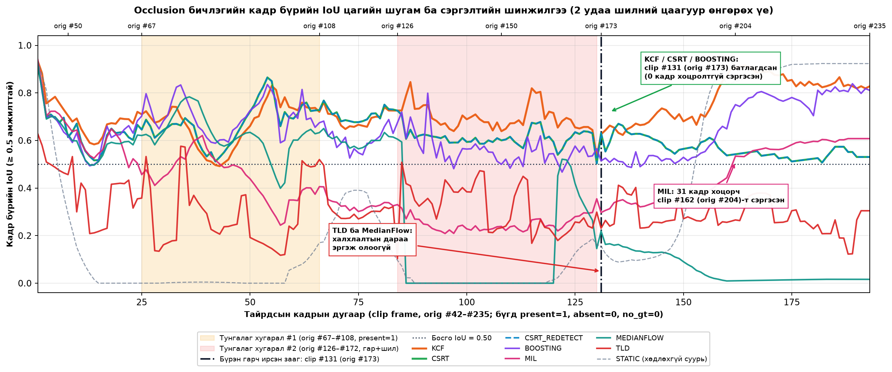

# Объект дагах ба оптик урсгал

Камер хөдөлж эсвэл объектын хэмжээ тэлж, дүрс нь гажихад дагагч алгоритмууд хэрхэн хариу үйлдэл үзүүлдэг вэ?


*Зураг 1. Бодит камерын `CC0 1.0` клип ([Léman Express, Wikimedia Commons](https://commons.wikimedia.org/wiki/File:Arriv%C3%A9e_en_gare_du_L%C3%A9man_Express_pour_Coppet_(2019-12-16).webm), зохиогч `Thibaut120094`, `orig #110–#260` буюу `0.00–5.00 сек`, бодит 1.0× хурдтай, `10 FPS`, 684 px). Зүүн талд гараар шошголсон **GT** (тасархай цагаан), баруун талд ижил кадр дээр **KCF** (`+` улбар шар, тогтмол хэмжээтэй, `Mean IoU = 0.4400`, `IoU 1.00 → 0.17`) ба **CSRT** (`[ ]` ногоон, хэмжээ тэлдэг, `Mean IoU = 0.7767`, бүх `150` кадрт `≥ 0.50`) хэрхэн зөрөхийг харуулав. [Хөдөлгөөнгүй гол кадр](results/figures/custom_videos/tracking_demo_keyframes.png) | [Энэ клипийн 8 аргын CSV](results/csv/phone_commons_leman_express_summary.csv) | [Хэрмийн бүрэн халхлалтын CC0 демо GIF](results/figures/custom_videos/squirrel_occlusion.gif).*

Энэ тайланд **IoU** гэдэг нь *хоёр хүрээ хэр давхцаж байгааг хэмждэг `0–1` оноо* (энэ туршилтад `IoU ≥ 0.50` бол амжилттай дагасан гэж үзнэ). Доорх жижиг хүснэгтэд гурван үндсэн видео туршилтын тус бүрийн нэг гол үр дүнг нэгтгэв ([дэлгэрэнгүй CSV](results/csv/phone_videos_summary.csv)):

| Туршилт (кадрын муж) | Камер ба нөхцөл | Шалгасан гол асуулт | Нэг гол тоон үр дүн |
| :--- | :--- | :--- | :--- |
| **`stable`** (`orig #664–#721`, 58 кадр) | Хөдөлгөөнгүй студи, томрох тэрэг | Машин ойртоход хүрээ тэлэх үү? | **`CSRT`** ба **`CSRT_REDETECT`** дундаж IoU **`0.8505`** (`100% ≥ 0.50`) |
| **`moving_camera`** (`orig #405–#515`, 111 кадр) | Тэрэгний `360°` камер, өвстэй талбай | Өвс урсахад нохойгоо алдах уу? | **`BOOSTING`** дундаж IoU **`0.5099`**. Нөхөлтийн дараа дэвсгэрийн хөдөлгөөн `#505`-д **35.85% буурч**, `#481`-д **24.20% өссөн** |
| **`occlusion`** (`orig #42–#235`, 194 кадр) | Тунгалаг хугарлын хавтан ба улаан алим | Алим шилний дараа яаж харагдав? | **`KCF`** дундаж IoU **`0.7190`**, **`CSRT`** `193/193` кадр бүрд `≥ 0.50` (`absent_frames = 0`) |

> **Эх дүрсний зөвшөөрлийн тэмдэглэл:** Хэмжилт хийсэн 3 видео (`Тогтвортой камертай жишээ.mp4`, `Камер өөрөө хөдөлж байгаа жишээ.mp4`, `Объект халхлагдаад дахин гарч ирэх жишээ.mp4`) нь контейнерийн метадата болон хайлтаар гаднын арилжааны/YouTube DASH бичлэгүүд (Subaru EyeSight сурталчилгаа, Insta360 нохойтой хөөцөлдөөн, Invisibility Shield линзний туршилт) болох нь харагдсан ч дахин нийтлэх чөлөөт лиценз нь баталгаажаагүй. Тиймээс зөвшөөрөл тодорхой болох хүртэл тэдгээрийн түүхий кадр ба overlay-г локалд (`results/local_only/`) хадгалж, README дээр **бодит зөвшөөрөлтэй `CC0 1.0` камерын дүрс (`Léman Express`)**, хэмжилтийн график, хүснэгтийг ашиглав ([NOTICE.md](NOTICE.md)).

---

## 1. Машин ойртоход хүрээ тэлэх үү?

Хөдөлгөөнгүй камерт (`stable`, `1920×1080`, `23.976 fps`) жижиг тэрэг баруун захаас төврүү ойртохдоо анхны `98×59 px` хэмжээнээсээ `121×87 px` болж талбай нь **1.82 дахин** томорсон. Хүрээний хэмжээг дагадаг **`CSRT`** болон **`MEDIANFLOW`** нь `0.8505` ба `0.8267` IoU авсан бол, тогтмол хэмжээтэй `KCF`, `BOOSTING`, `MIL` тэрэгний төв дээр тогтсон ч тэлээгүй тул `0.72–0.73` дээр тогтсон, харин `TLD` жижиг дээвэр дээр хумигдаж `0.4070` болсон ([phone_stable_summary.csv](results/csv/phone_stable_summary.csv)).


*Зураг 2. `stable` тайрдсын (`orig #664–#721`) тэлэлтийн муруй ба 8 аргын дундаж IoU. `CSRT` ба `CSRT_REDETECT` ижил `0.8505` авч `100%` `≥ 0.50` байв. Бодит камерт ойртож томрох ижил үзэгдэл `CC0 Léman Express`-ийн дараах гурван кадрт харагдана:*


*Зураг 3. Нүүрний `tracking_demo.gif`-ийн эхлэл (`0.00с`), дунд (`2.50с`), төгсгөл (`5.00с`) кадрууд. Ижил scale ба crop дээр `KCF` тогтмол жижиг хүрээтэй үлдсэн бол `CSRT` ойртох хөдөлгөөнийг дагаж тэлсэн.*

---

## 2. Өвс урсахад нохойгоо алдах уу?

`moving_camera` (`1920×1080`, `25.0 fps`, `orig #405–#515`) бичлэгт тэргэн дээрх `360°` камер урагш давхиж бас эргэхэд арын хуурай өвс маш хурдан урсдаг. **Optical flow**-ээр (`DIS_MEDIUM`) дэвсгэрийн глобал хөдөлгөөнийг `RANSAC 2D affine`-ээр хасахад эргэлт голлосон **`orig #505`** кадрт дэвсгэрийн медиан хөдөлгөөн `5.26 px → 3.37 px` болж **35.85% буурсан** (`inlier = 60.0%`). Харин **`orig #481`** кадрт 2D загварт тохирсон цэгийн хувь `34.1%` болж, нөхөлтийн дараах дэвсгэрийн хөдөлгөөн **`8.29 px → 10.30 px`** буюу **24.20% өссөн**. Ойрын өвсний параллакс болон `360°` линзийн гажилт үүнд нөлөөлсөн байж болно ([phone_moving_camera_flow_pairs.csv](results/csv/phone_moving_camera_flow_pairs.csv)).

Энд хоёр өөр хэмжүүрийг салгаж ойлгох нь чухал:
1. **Буурсан хөдөлгөөний хэмжээ (`px` ба `%`):** Камерын эргэлтийг хассаны дараа *дэвсгэр пикселүүдийн хөдөлгөөний хурд* хэр багассаныг хэмжинэ (28 хосын медиан `+13.62%`). Энэ нь дүрс тогтворжуулалтын хэмжүүр бөгөөд `flow GT` байхгүй тул **EPE биш**.
2. **Тэмдэглэсэн хүрээтэй давхцах байдал (`IoU`):** Нохойны бодит хүрээтэй харьцуулахад **`BOOSTING` (`0.5099`)**, `STATIC` (`0.4806` — оператор нохойг төвд барьдаг тул), **`CSRT` (`0.4695`)** нохойг дагасан бол **`MEDIANFLOW` (`0.1180`)** ба **`MIL` (`0.2088`)** арын өвсний урсгалд татагдаж хоцорсон ([phone_moving_camera_summary.csv](results/csv/phone_moving_camera_summary.csv)).


*Зураг 4. Эх дүрсгүй цэвэр `DIS` урсгалын `HSV` зураглал (`max = 12 px`). `orig #505`-т тэнгэрийн хаяа/мод бараан болж нохой тодорсон бол `orig #481`-т зүүн дээд модны хэсэгт affine загвар эвдэрч ягаан үлдэгдэл урсгал нэмэгджээ.*

---

## 3. Алим шилний дараа яаж харагдав?

Босоо линз хавтан нь улаан алимыг бүдгэрүүлэн хэвтээ сунгадаг боловч бүрэн нуудаггүй тул **`occlusion` тайрдсын (`orig #42–#235`, `194` кадр) бүх кадрт алим харагдсан (`absent_frames = 0`)**. Шилний цаана алим сунаж харагдсан ч **`CSRT` (`0.6225`) болон `CSRT_REDETECT` (`0.6225`) нь `193` үнэлгээний кадр бүрд (`100%`) `0.5` босгыг давж тасралтгүй дагасан**. Харин тогтмол авсаархан хүрээтэй **`KCF` хамгийн өндөр дундаж `IoU = 0.7190` (`98.96% ≥ 0.5`)** авсан бол `TLD` (`5.18% ≥ 0.5`) болон `MEDIANFLOW` (`fail = 18.13%`) шилний зураасанд төөрч шилний дараа эргэж олоогүй ([phone_occlusion_summary.csv](results/csv/phone_occlusion_summary.csv)).

- **Бүрэн `0%` халхлалтаас тусад нь ялгах нь:** `occlusion` бичлэг нь тунгалаг хугаралт (`absent_frames = 0`) тул `CSRT` огт тасраагүй (`redetect_calls = 0`). Объект **`0%` харагдахаар бүрэн далд ороод нөгөө талаас гарч ирэх** үед хэрхэн ажилладгийг доорх 4-р хэсэгт хэмжлээ.


*Зураг 5. `occlusion` бичлэгийн `193` үнэлгээний кадр бүрийн IoU. `KCF` өндөр дундажтай (`0.7190`), `CSRT` кадр бүрд тасралтгүй `≥ 0.50` байсан бол `MIL` `31` кадр хоцорч, `TLD`/`MEDIANFLOW` сэргээгүй.*

---

## 4. Хэрэм модны цаагуур ороход дагагч эргэж олох уу?

Шалгасан Wikimedia Commons-ийн есөн бичлэгт нэг хэрэм модны цаагуур бүрэн ороод нөгөө талаас гарах тасралтгүй хэсэг таараагүй. Тиймээс `TylerMascola`-ийн хэрмийн фото, `Ilikecheese`-ийн модны фотогоор `squirrel_occlusion` хяналттай дарааллыг үүсгэв. Хоёр фото `CC0 1.0` лицензтэй. Дараалал нь `720×420`, `66` кадр, `12 FPS` буюу `5.50 сек`. [Дараалал үүсгэх код](squirrel_occlusion_lab.py) · [Зургийн эх сурвалж](NOTICE.md)

Харагдах маск 25-аас цөөн пикселтэй бол хүрээний үнэлгээнд далд гэж тэмдэглэсэн. `#28`-д маскны **0.05%** үлдсэн, `#29–#36`-д харагдах маск 0 байв. `#37`-д хэрэм дахин харагдах босгыг давсан. Нийт **9 кадр далд** гэж үнэлсэн. Дундаж IoU-д анхны кадрыг хасаад харагдах **56 кадр** орсон. [Кадрын шошго](results/csv/squirrel_occlusion_gt.csv)


*Зураг 6. KCF `#23`-аас хүрээ гаргахаа больж, далд гэж үнэлсэн 9 кадрт буруу хүрээ гаргаагүй (0/9). Энэ тайрдаст хэрмийг эргэж олоогүй. TLD тэр 9 кадр бүрд буруу хүрээ гаргасан (9/9). Хэрэм нөгөө талаас гарсны дараа TLD-ийн IoU `#49`-д `0.7535` болж, `#51`-д гурван кадрын шалгуур батлагдсан.*


*Зураг 7. Хэрэм `#15`-д харагдаж, `#32`-т бүрэн далд орсон. `#51`-д TLD-ийн сэргэлт батлагдсан ч CSRT ба CSRT_REDETECT-ийн хүрээ модны их бие дээр үлдсэн. Энэ туршилтад CSRT_REDETECT дахин хайлтаа асаагаагүй (`redetect_calls = 0`). [Бүрэн хэмжилт](results/csv/squirrel_occlusion_summary.csv).*

Хүснэгтийн `Failure %` нь харагдах кадрт хүчинтэй хүрээ гараагүй хувийг заана. `FP` нь далд гэж үнэлсэн кадрт гарсан буруу хүрээ. Сэргэлтийг хэрэм дахин харагдсан `#37`-оос тоолж, IoU ≥ 0.50 гурван кадр дараалан хүрсэн эхний ба баталгаажсан кадрыг бичив.

| Алгоритм | Mean IoU | IoU ≥ 0.50 | Failure % | Далд кадрын FP (`9` кадр) | Сэргэлт (`first/confirmed`) | Algo FPS |
| :--- | :---: | :---: | :---: | :---: | :---: | :---: |
| **`TLD`** | **0.5131** | **66.07%** | 0.00% | 9 / 9 (`100%`) | **`12 / 14` (`#49 / #51`)** | 49.15 |
| `MEDIANFLOW` | 0.3672 | 37.50% | 0.00% | 9 / 9 (`100%`) | Эргэж олоогүй | **1259.15** |
| `MIL` | 0.3543 | 35.71% | 0.00% | 9 / 9 (`100%`) | Эргэж олоогүй | 52.40 |
| `CSRT` / `CSRT_REDETECT` | 0.3533 | 35.71% | 0.00% | 9 / 9 (`100%`), `redet=0` | Эргэж олоогүй | 54.03 / 53.10 |
| `BOOSTING` | 0.3415 | 35.71% | 0.00% | 9 / 9 (`100%`) | Эргэж олоогүй | 46.65 |
| **`KCF`** | 0.3043 | 35.71% | 60.71% | **`0 / 9` (`0.00%`)** | Эргэж олоогүй | 827.39 |
| `STATIC` *(суурь)* | 0.0862 | 7.14% | 0.00% | 9 / 9 (`100%`) | Эргэж олоогүй | *(хассан)* |

---

## Дүгнэлт


*Зураг 8. Зүүн талд (`CC0 Léman Express #260`): хэмжээ нь тэлдэг `CSRT` (`0.83`) ойртож буй галт тэргийг бүтэн барьсан бол тогтмол хэмжээтэй `KCF` (`0.17`) жижиг хэвээр хоцорсон. Баруун талд (`CC0` хэрмийн бүрэн халхлалт `#51`, `+14` кадр): модны их биеийн цаанаас гарч ирэхэд **`TLD` (`0.77`)** цорын ганц сэргэсэн бол **`CSRT` ба `CSRT_REDETECT` (`0.00`)** хүрэн холтос дээр гацаж, **`KCF`** нь `0/9` хуурамч хүрээгүйгээр **`Алдсан`** хэвээр үлдсэн.*

Тогтвортой камерын туршилтад CSRT ба CSRT_REDETECT хамгийн өндөр дундаж IoU авсан. Алимны бичлэгт KCF хамгийн өндөр дундажтай, CSRT 193 үнэлгээний кадр бүрд 0.50 босгыг хангасан. Хэрмийн дараалалд TLD эргэж олсон ч далд гэж үнэлсэн бүх кадрт буруу хүрээ гаргав. KCF далд үед хүрээ гаргаагүй ч дараа нь эргэж олоогүй. CSRT_REDETECT-ийн үр дүн эхээс шалтгаалсан. Дугуйн хяналттай туршилтад дахин олсон ч хэрмийн болон LaSOT-ийн туршилтад эргэж олоогүй. [Хэрмийн хэмжилт](results/csv/squirrel_occlusion_summary.csv) · [Дугуйн хэмжилт](results/csv/track_summary.csv) · [LaSOT хэмжилт](results/csv/track_generalization_lasot.csv)

---

## Лабораторийн суурь туршилтууд, зассан баримтууд ба дахин ажиллуулах заавар

### Нэмэлт туршилт: `CC0 Léman Express` (`orig #110–#260`, 151 кадр @ 30 FPS)
Нүүрний GIF болон хөдөлгөөнгүй кадрын бодит үнэлгээний бүтэн үр дүн ([phone_commons_leman_express_summary.csv](results/csv/phone_commons_leman_express_summary.csv)):

| Tracker | Mean IoU | IoU ≥ 0.50 (%) | Failure % | Algo ms (FPS) | E2E ms (FPS) |
| :--- | :---: | :---: | :---: | :---: | :---: |
| **`MEDIANFLOW`** | **0.7851** | **100.00%** | 0.0% | 2.09 (477.81) | 10.16 (98.46) |
| **`CSRT`** | **0.7767** | **100.00%** | 0.0% | 27.37 (36.53) | 37.38 (26.75) |
| **`CSRT_REDETECT`** | **0.7767** | **100.00%** | 0.0% | 27.68 (36.13) | 37.79 (26.46) |
| `TLD` | 0.4595 | 32.00% | 0.0% | 56.88 (17.58) | 60.87 (16.43) |
| `MIL` | 0.4401 | 34.00% | 0.0% | 18.45 (54.20) | 27.68 (36.13) |
| **`KCF`** | **0.4400** | **34.00%** | 0.0% | 3.49 (286.41) | 18.69 (53.50) |
| `BOOSTING` | 0.4327 | 31.33% | 0.0% | 32.59 (30.68) | 41.76 (23.95) |
| `STATIC` *(суурь)* | 0.2870 | 22.67% | 0.0% | — | 8.11 (123.29) |

> Dense flow & камер нөхөлт (`orig #110–#260`, `phone_commons_leman_express_flow_pairs.csv`): камер дагах эргэлт хийдэг `#246` кадрт `DIS_MEDIUM` дэвсгэрийн хөдөлгөөнийг **89.98%** (`3.56 px → 0.36 px`) дарсан; бүх 38 хосын медиан бууралт **74.91%** (`LK 10/10 = 100%`).

### Өмнөх үндсэн судалгаа ба PDF давталт (баталгаажуулж шинэчилсэн тоо)
- **Сургалтын PDF-ийн давталт ([reproduce_pdf.py](reproduce_pdf.py)):**
  - `06-Tracking-APIs.ipynb - Colaboratory.pdf` (х. 1–2): `BOOSTING`, `MIL`, `KCF`, `TLD`, `MEDIANFLOW` API ба `cv2.legacy` binding шалгалт (`4.14.0` болон `5.0.0`, [tracker_bindings_cv414.csv](results/csv/tracker_bindings_cv414.csv)).
  - `06-Optical-Flow.ipynb - Colaboratory.pdf` (х. 1–3): `Shi–Tomasi + LK (winSize=200×200)` болон `Farnebäck` dense HSV (`max=12 px` тогтмол масштаб) + вебкамер `smoke run` (`12/12`, [webcam_smoke.csv](results/csv/webcam_smoke.csv)).
- **Халхлалтын шатлал ба дистрактор ([track_occlusion_ladder.csv](results/csv/track_occlusion_ladder.csv)):** Халхлалтын бодитоор хэмжсэн шатлал нь **`3`, `11`, `22` кадр** (`absent_frames = 3, 11, 22`). `11` кадр + төстэй объекттой нөхцөлд **`TLD` `31` кадр (`distractor_jumps = 31`) хуурамч объект руу андуурч `0.1971`** болсон бол `CSRT_REDETECT` **`0.6529`** авсан.
- **Нийтийн Optical Flow EPE (`all_valid_px_epe`, [flow_summary.csv](results/csv/flow_summary.csv)):**
  - `Middlebury`: **`DIS_MEDIUM`-ийн `0.226–0.319 px`** хүрээ нь зөвхөн `Middlebury`-ийн хоёр хост (`RubberWhale = 0.2258 px`, `Grove2 = 0.3189 px`) хамаарна (`Farnebäck 0.3612` ба `0.5852 px`).
  - `MPI Sintel`: сонгосон хоёр хосын үнэн пиксел EPE нь тусдаа — `alley_1 clean` дээр `DIS_MEDIUM = 0.2581 px` (`Farnebäck 0.8406 px`), харин хурдан хөдөлгөөнт `ambush_5 final` дээр `DIS_MEDIUM = 2.4601 px` (`Farnebäck 4.1480 px`).
  - Ижил судалгааны нэгдсэн график ба Word хувилбар: [tracking_flow_metrics.png](results/figures/tracking_flow_metrics.png), [flow_error_and_dis_cc0.png](results/figures/flow_error_and_dis_cc0.png), `Tracking_Lab_Report_MN.docx` ([build_report.py](build_report.py)).

### Гурван үндсэн видеоны 8 алгоритмын бүтэн хэмжилт ([phone_videos_summary.csv](results/csv/phone_videos_summary.csv))
`STATIC` нь алгоритмын тооцоололгүй суурь хүрээ тул хурдны эрэмбэлэлтээс хасав (`1 CPU thread`, median/p95).

| Бичлэг | Tracker | Mean IoU | IoU ≥ 0.50 (%) | Failure % | Drift (`IoU<0.2`) | Сэргэлт (`first/conf`) | Algo FPS | E2E FPS |
| :--- | :--- | :---: | :---: | :---: | :---: | :---: | :---: | :---: |
| `stable` | **`CSRT`** / **`CSRT_REDETECT`** | **0.8505** | **100.00%** | 0.0% | 0 | — | 53.78 / 50.68 | 35.08 / 35.35 |
| `stable` | `MEDIANFLOW` | 0.8267 | 100.00% | 0.0% | 0 | — | 192.88 | 71.41 |
| `stable` | `MIL` / `BOOSTING` / `KCF` | 0.7316 / 0.7268 / 0.7213 | 100.00% | 0.0% | 0 | — | 35.3–139.0 | 32.5–40.0 |
| `stable` | `TLD` | 0.4070 | 26.32% | 0.0% | 0 | — | 15.48 | 12.91 |
| `stable` | `STATIC` *(суурь)* | 0.0917 | 7.02% | 0.0% | 48 | — | *(хассан)* | 119.68 |
| `moving_camera` | **`BOOSTING`** | **0.5099** | **57.27%** | 0.0% | 1 | — | 46.72 | 24.72 |
| `moving_camera` | `STATIC` *(суурь)* | 0.4806 | 41.82% | 0.0% | 0 | — | *(хассан)* | 56.47 |
| `moving_camera` | `CSRT` / `CSRT_REDETECT` | 0.4695 | 40.00% | 0.0% | 1 | — | 25.58 / 25.07 | 15.83 / 15.65 |
| `moving_camera` | `KCF` | 0.3888 | 22.73% | 12.73% | 1 | — | 33.23 | 15.44 |
| `moving_camera` | `TLD` / `MIL` / `MEDIANFLOW` | 0.3168 / 0.2088 / 0.1180 | 32.73 / 9.09 / 3.64% | 0.0% | 46 / 70 / 88 | — | 18.2–206.1 | 14.0–43.7 |
| `occlusion` | **`KCF`** | **0.7190** | 98.96% | 0.0% | 0 | Шилний дараа `≥0.5` (`#131/133`) | 68.88 | 35.73 |
| `occlusion` | **`CSRT`** / **`CSRT_REDETECT`** | **0.6225** | **100.00%** | 0.0% | 0 | **Тасралтгүй (`193/193`)** | 33.92 / 33.21 | 25.32 / 24.91 |
| `occlusion` | `BOOSTING` | 0.6395 | 94.82% | 0.0% | 0 | Шилний дараа `≥0.5` (`#131/133`) | 35.67 | 28.73 |
| `occlusion` | `MIL` | 0.4187 | 34.20% | 0.0% | 0 | 31 / 33 (`162/164`) | 54.03 | 39.58 |
| `occlusion` | `MEDIANFLOW` | 0.3099 | 41.97% | 18.13% | 63 | Эргэж олоогүй | 500.86 | 114.63 |
| `occlusion` | `TLD` | 0.3058 | 5.18% | 0.0% | 23 | Эргэж олоогүй | 16.70 | 15.02 |
| `occlusion` | `STATIC` *(суурь)* | 0.2695 | 23.83% | 0.0% | 126 | 22 / 24 (`153/155`) | *(хассан)* | 149.65 |

### Хэрмийн GIF-ийг дахин үүсгэх

Төслийн үндсэн хавтсаас ажиллуул. Хэрмийн хоёр эх фотог скрипт өөрөө татна. GIF үүсгэхэд `ffmpeg` болон DejaVu Sans фонтууд хэрэгтэй.

```bash
python3 -m venv .venv && source .venv/bin/activate
pip install -r requirements.txt
python squirrel_occlusion_lab.py --rebuild-seq
python make_three_videos_figures.py --only-squirrel
```

Дээрх команд хэрмийн GIF болон гурван кадрын PNG-г `results/figures/custom_videos/`-д гаргана.

### Бүх туршилтыг дахин ажиллуулах
- **Орчин:** Linux (`x86_64`), Intel(R) Core(TM) 5 120U (`1 thread`), Python `3.14.4`, `opencv-contrib-python==4.14.0.94`, `ffmpeg 8.0.1`.
- **Код & өгөгдлийн скриптүүд:** [config.py](config.py), [metrics.py](metrics.py), [trackers.py](trackers.py), [dataset_prep.py](dataset_prep.py), [reproduce_pdf.py](reproduce_pdf.py), [benchmark_track.py](benchmark_track.py), [benchmark_flow.py](benchmark_flow.py), [custom_video_lab.py](custom_video_lab.py), [squirrel_occlusion_lab.py](squirrel_occlusion_lab.py), [make_figure.py](make_figure.py), [make_three_videos_figures.py](make_three_videos_figures.py), [tests/test_metrics_and_pipeline.py](tests/test_metrics_and_pipeline.py).

Гурван үндсэн видеог `data/phone_videos/` дотор `stable.mp4`, `moving_camera.mp4`, `occlusion.mp4` нэрээр байрлуул. Эх бичлэгийн кадрын муж нь дээрх хүснэгттэй таарах ёстой. Галт тэрэгний эх видеог доорх командаар татна. [Эх өгөгдлийн бүртгэл](NOTICE.md)

```bash
python3 -m venv .venv && source .venv/bin/activate
pip install --upgrade pip && pip install -r requirements.txt

mkdir -p data/commons
curl -fL -o data/commons/leman_express_cc0.webm \
  'https://upload.wikimedia.org/wikipedia/commons/9/9b/Arriv%C3%A9e_en_gare_du_L%C3%A9man_Express_pour_Coppet_%282019-12-16%29.webm'

python dataset_prep.py --all
python benchmark_flow.py && python benchmark_track.py
python custom_video_lab.py --run-three
python squirrel_occlusion_lab.py --rebuild-seq
python custom_video_lab.py --evaluate data/commons/leman_express_cc0.webm \
  --gt results/csv/commons_leman_express_gt.csv --start-frame 110 --end-frame 260 --seq-id commons_leman_express
python make_figure.py && python make_three_videos_figures.py
python -m unittest discover -s tests -v
```
